SUPER-ADMIN-ORG · SUPER ADMIN

# User journeys: the admin panel

Easy guide for administrators, content editors, developers and the project team

This guide shows, with pictures, what you see when you sign in to a Super Admin panel, what every button on a page does, where each one takes you, and how a developer adds a page in a few lines of PHP. The red numbers on the pictures are explained in the table under each picture. Every role has its own section; read the sections for everyone first, then only yours.

| If you are… | Read |
| --- | --- |
| Anyone who signs in to the panel (first day) | Sections 1 – 4 |
| A content editor or staff member who works with lists and forms | Sections 1 – 4, then 5 – 9 |
| An administrator who manages users, roles, permissions and the menu | Sections 1 – 4, then 10 |
| A developer who builds the pages | Sections 1 – 4, then 11 |
| In the project team (install, test accounts, updates, deployment) | Section 12 and the README, CHANGELOG and docs/user-manual files |
| Looking for an answer to a specific question | Sections 13 and 14 |

Version 1.0 · 14 October 2026 · Screens from the local demo copy of the panel (Super Admin 1.3.0, Tailwind Light template, demo "Posts" resource)

---

## 1. The admin panel in five steps

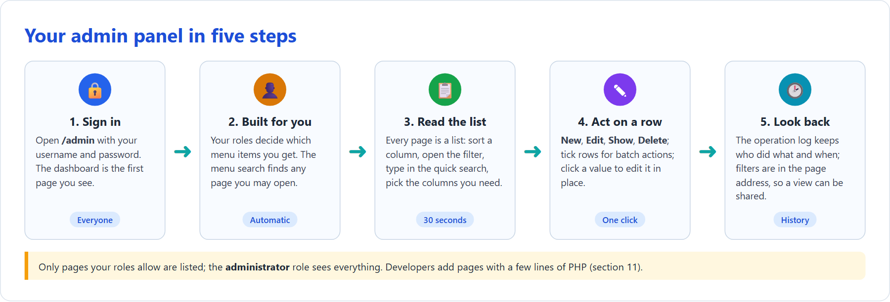

*The five steps: sign in, the menu is built for your role, read the list, act on a row, look back in the log*

The panel is a set of pages, one per thing you manage (posts, products, users…). Every page is the same shape: a list you can sort, filter and export, a form to create or edit one record, and a detail page. What you may open is decided by your roles, so two people can sign in to the same panel and see different menus.

> **Tip:** You do not have to learn new pages for new data. When a developer adds a resource (section 11) it gets the same list, form and detail page as every other one, with the same buttons in the same places.

## 2. Which pages do I get?

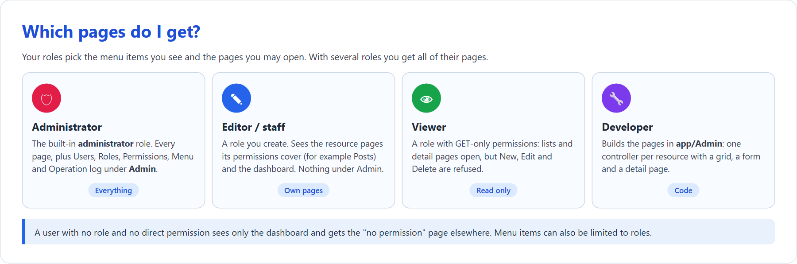

*The menu and the pages you may open depend on your roles*

| Your role | Menu you see | What you may do |
| --- | --- | --- |
| **administrator** (built in) | Everything, including **Admin → Users, Roles, Permission, Menu, Operation log** | Everything; no permission check applies |
| A role made by your administrator, for example *Editor* | The dashboard and the resources its permissions cover (for example **Posts**) | What the permission paths and HTTP methods allow (section 10) |
| A role with GET-only permissions | The same pages | Open lists and detail pages; **New**, **Edit**, **Delete** are refused |
| No role, no permission | The dashboard | Every other page shows *Permission denied* |

With several roles you get the pages of all of them. An item in the menu can additionally be limited to roles, so a page you may open can still be left out of the menu to keep it short.

> **Remember:** The panel keeps its own users. Signing in to the website does not sign you in to the panel, and the other way round.

## 3. Sign in and find the dashboard

Open `/admin` on your site (for example `https://example.com/admin`), type your username and password and click **Login**.

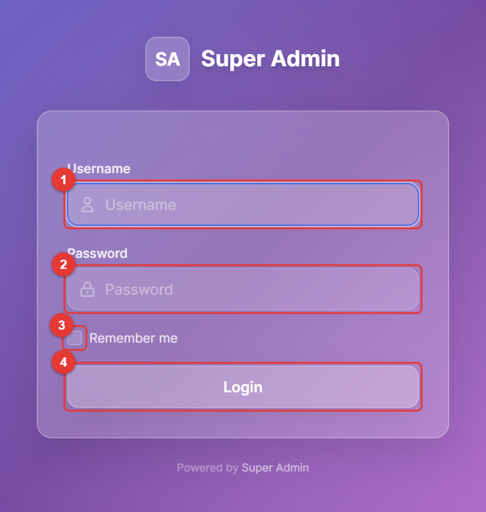

*The login page*

| # | What it is |
| --- | --- |
| 1 | **Username** – the name your administrator gave you (not an e-mail address). |
| 2 | **Password** – your panel password. |
| 3 | **Remember me** – keeps you signed in on this browser until you log out. |
| 4 | **Login** – opens the dashboard. A wrong username or password shows a red message under the field. |

The dashboard opens right after you sign in. To come back to it from any page, click the brand in the top-left corner of the sidebar or the house symbol at the start of the breadcrumb.

> **Tip:** Five wrong passwords in a row lock the login for 15 minutes; the page says so. The time is set by the administrator (`auth.throttle_timeout`).

> **Remember:** Change the password you were given on your first day: user menu (top right) → **Setting** → section 10.6.

## 4. The page at a glance

On a desktop the dark sidebar on the left holds the brand, the menu search and the menu; the white bar at the top holds the sidebar toggle and your user menu; the page content sits in cards.

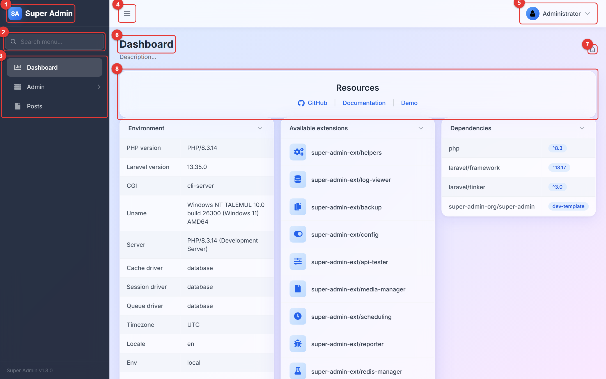

*The dashboard on a desktop*

| # | What it is | Where it takes you |
| --- | --- | --- |
| 1 | **Brand** – the panel name set by the administrator. | Click it to open the dashboard. |
| 2 | **Menu search** – type a few letters of a page name ("post", "user") and pick a page from the list. Only pages you may open are listed. | Click a result to open that page; Enter opens the first one. |
| 3 | **Menu** – your pages. A row with an arrow is a group: click it to fold or unfold. The page you are on is highlighted. | Click a row to open the page. |
| 4 | **Sidebar toggle** – shrinks the sidebar to icons to give the content more room; click again to restore. | No link. |
| 5 | **User menu** – your name and avatar. | Opens **Setting** and **Logout** (next picture). |
| 6 | **Page title and description** – what the page is and whether you are on the list, create, edit or show view. | Read only. |
| 7 | **Breadcrumb** – where you are. | Click a part to go up one level; the house opens the dashboard. |
| 8 | **Content** – the cards of the page. On the dashboard: resources, environment, extensions and dependencies. | Links inside the cards open in a new tab. |

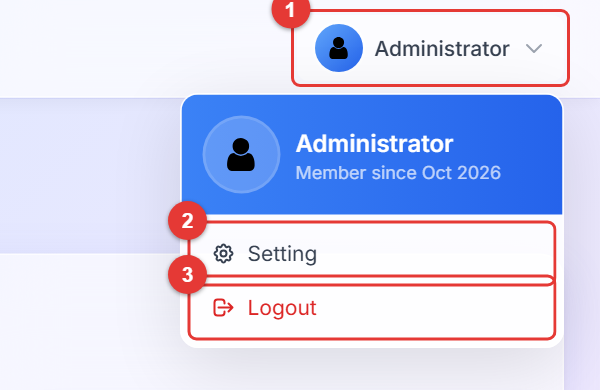

*The user menu*

| # | What it is | Where it takes you |
| --- | --- | --- |
| 1 | **Your name** – click to open the menu. | — |
| 2 | **Setting** – your own name, avatar and password. | Opens the setting page (section 10.6). |
| 3 | **Logout** – ends the session. | Back to the login page. |

On a phone the sidebar is hidden; the menu button in the top bar slides it over the page, and the search box and menu work the same way.

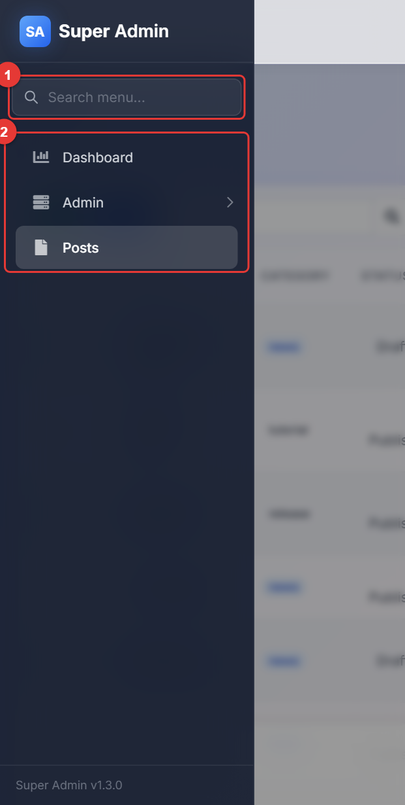

*The menu opened on a phone (the ☰ button in the top bar)*

| # | What it is |
| --- | --- |
| 1 | **Menu search** – the same search as on a desktop. |
| 2 | **Menu** – tap a row to open the page; the sidebar closes by itself. Tap the dark area to close it without choosing. |

> **Tip:** Pages load without a full refresh (the sidebar stays in place while the content changes). The browser's Back button still works, and every page has its own address you can bookmark.

## 5. Reading a list

Every resource opens as a list. The picture shows the demo **Posts** list; your lists have other columns but the same frame.

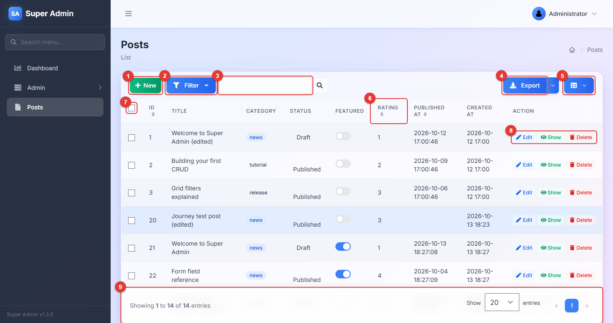

*A list page: toolbar, column headers, rows with actions, and the sticky footer*

| # | What it is | Where it takes you |
| --- | --- | --- |
| 1 | **New** – create a record. | Opens the create form (section 7). |
| 2 | **Filter** – opens or closes the filter panel under the toolbar (section 6). | — |
| 3 | **Quick search** – type and press Enter to search the configured columns (here the title). | The list reloads with the matching rows; the address gets `?__search__=…`. |
| 4 | **Export** – downloads a CSV file. The arrow next to it offers *All*, *Current page* and *Selected rows*. | A file download. |
| 5 | **Column selector** – tick the columns you want to see; the choice is kept in your browser. | — |
| 6 | **Column header** – a header with arrows sorts the list; click again to reverse. Only columns the developer made sortable have arrows. | The list reloads sorted; the address gets `?_sort[column]=…`. |
| 7 | **Row checkboxes** – tick rows for a batch action (section 8). The checkbox in the header ticks all rows of the page. | — |
| 8 | **Row actions** – **Edit**, **Show** and **Delete** for that row. Developers can add their own, for example *Publish*. | Edit opens the form, Show the detail page, Delete asks for confirmation first. |
| 9 | **Footer** – "Showing 1 to 14 of 14 entries", the page-size selector (10 to 100 rows) and the pager. The footer stays visible while you scroll. | Page numbers reload the list; the address gets `?page=…`. |

Good to know about lists:

- A coloured chip in a cell (here *news*) is a label the developer chose for that value; a coloured dot before a word is a status.
- A switch in a cell (here *Featured*) changes the record immediately when you click it, with a toast at the top right.
- A pencil next to a value means you can edit it in place (section 8).
- Dates are shown as stored; the developer can format them.
- An empty list shows a box icon and "No records found".

> **Remember:** The quick search, the filter, the sort and the page number are all part of the page address. Copy the address from the browser to share exactly the rows you are looking at, or bookmark it.

## 6. Finding records: filters, search, columns, export

Click **Filter** to open the filter panel. The fields in it are chosen by the developer; text fields match part of the value, selects match exactly, date ranges take a start and an end.

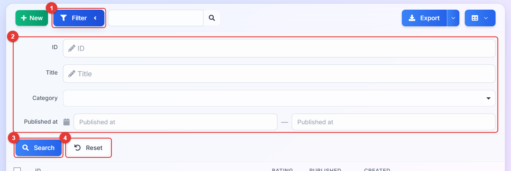

*The filter panel open on the Posts list*

| # | What it is | Where it takes you |
| --- | --- | --- |
| 1 | **Filter** – shows and hides the panel. The arrow turns when the panel is open. | — |
| 2 | **Filter fields** – one row per field: text (ID, Title), select (Category), date range (Published at), and others. Fill in any of them. | — |
| 3 | **Search** – applies the filters. | The list reloads with the matching rows; the filters are in the address. |
| 4 | **Reset** – clears every filter. | The full list again. |

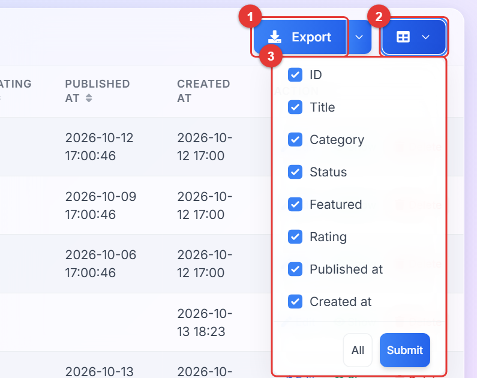

*Export (left) and the column selector (right), with the selector open*

| # | What it is | Where it takes you |
| --- | --- | --- |
| 1 | **Export** – the button downloads all rows as CSV. The small arrow next to it offers *All*, *Current page* and *Selected rows* (tick rows first). | A file named after the resource, for example `posts.csv`. |
| 2 | **Column selector** – opens the list of columns. | — |
| 3 | **Column list** – untick a column to hide it, **All** ticks everything, **Submit** applies the choice. The choice is remembered in this browser. | The list reloads with the chosen columns. |

> **Tip:** The export respects the current filter and search, so "filter first, then export" is the way to get exactly the rows you need in a spreadsheet.

> **Tip:** The list does not need a page refresh to update; if you believe it is stale, the **Refresh** keyboard shortcut is F5 as in any page, and the browser Back button returns to the previous filter.

## 7. Changing data: the form

**New** and **Edit** open the same form. Fields can be grouped in tabs; the footer keeps the buttons in reach while you scroll.

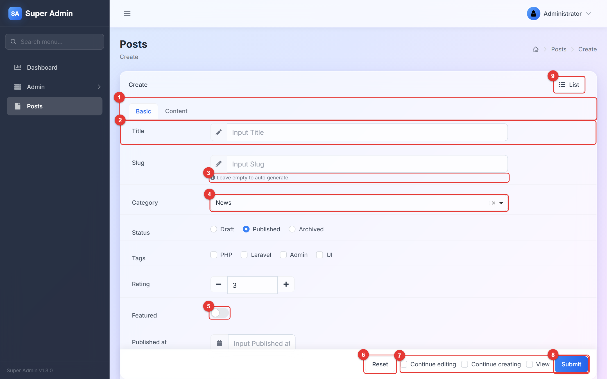

*The create form of the demo Posts resource*

| # | What it is | Where it takes you |
| --- | --- | --- |
| 1 | **Tabs** – groups of fields. A tab with a field in error gets a red marker after you submit. | Click a tab to show its fields; nothing is saved by switching. |
| 2 | **Field row** – label on the left, control on the right. A red asterisk on the label means required. | — |
| 3 | **Help text** – a hint under the control. | — |
| 4 | **Select** – a drop-down with search; the × clears it. Multi-selects show chips for each chosen value. | — |
| 5 | **Switch** – on/off. Radios, checkboxes, number steppers, date pickers, colour pickers, sliders and file fields look like their native controls. | — |
| 6 | **Reset** – puts every field back to the value it had when the page opened. | — |
| 7 | **After-save options** – what happens after a successful save: *Continue editing* (stay on the edit form), *Continue creating* (an empty form again), *View* (the detail page). With none ticked you return to the list. | — |
| 8 | **Submit** – saves. Required fields that are empty are flagged before anything is sent. | The list (or the choice in 7), with a green *Save succeeded* toast. |
| 9 | **List** – back to the list without saving. (Edit forms also have **View** and **Delete** here.) | The list. |

When the server rejects a value (a duplicate slug, a date in the wrong format, a rule the developer wrote), the form comes back with the message under the field and a marker on its tab:

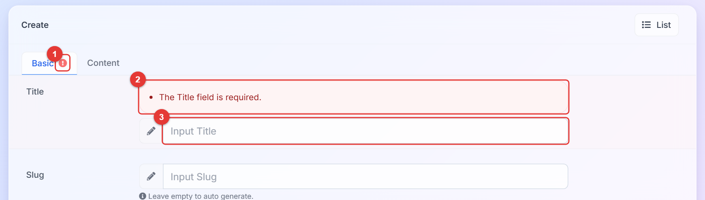

*The form after submitting without a title*

| # | What it is |
| --- | --- |
| 1 | **Tab marker** – the tab that holds the field in error. The form switches to it. |
| 2 | **Message** – the rule that failed, in plain words. |
| 3 | **Field** – the row is tinted so you find it quickly. Your other values are kept. |

File and image fields show what is stored and let you replace or remove it:

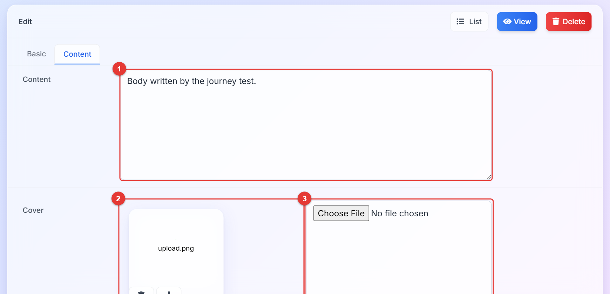

*The Content tab of an existing post with its cover image*

| # | What it is |
| --- | --- |
| 1 | **Text area** – long text; some projects replace it with a rich-text editor. |
| 2 | **Current file** – the stored image with its name; the bin removes it on the next save, the arrow downloads it. |
| 3 | **Choose file** – pick a new file; it replaces the current one when you submit. Allowed types and sizes are set by the developer. |

> **Tip:** Nothing is saved until you press **Submit**. Leaving the page loses your changes; the panel does not warn you.

> **Remember:** *Continue creating* is the fast way to enter many records in a row: the form comes back empty with the same tab open.

## 8. Acting on rows: edit in place, delete, batch actions

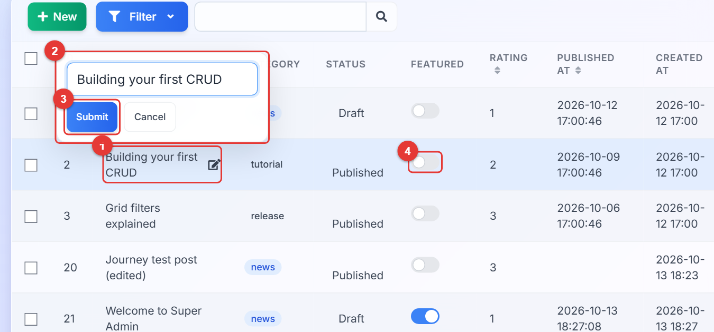

*Editing a title in the list without opening the form*

| # | What it is | Where it takes you |
| --- | --- | --- |
| 1 | **Editable cell** – a pencil appears when you point at it. Click the value to open the editor. | — |
| 2 | **Editor popover** – the control for that column (text, select, date…) with the current value. | — |
| 3 | **Submit** – saves that one value; **Cancel** or a click elsewhere closes the editor. | The cell updates and a toast confirms. |
| 4 | **Switch column** – click to toggle; it saves immediately. | A toast confirms. |

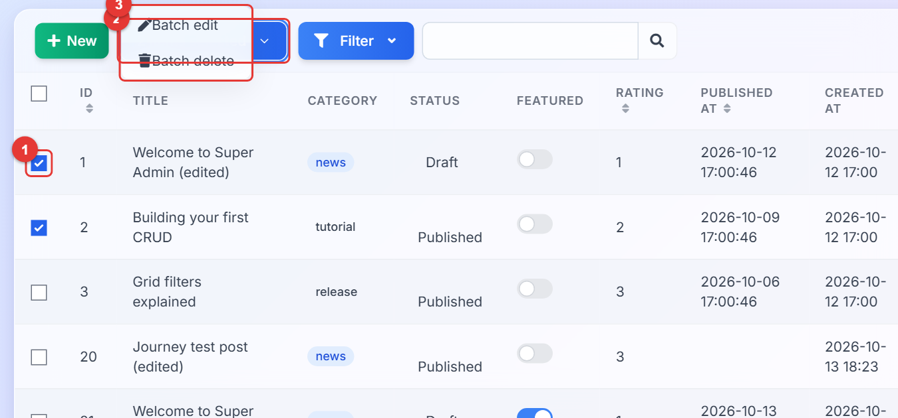

*Two rows ticked and the batch menu open*

| # | What it is | Where it takes you |
| --- | --- | --- |
| 1 | **Row checkboxes** – tick the rows the action should apply to. The count shows on the batch button. | — |
| 2 | **Batch button** – appears as soon as a row is ticked. | Opens the batch menu. |
| 3 | **Batch menu** – **Batch delete** (asks for confirmation) and **Batch edit** (opens the edit form for the ticked rows) are built in; developers can add more (section 11). | The list reloads when the action is done. |

Deleting a single row works the same way: **Delete** in the row's actions asks *Are you sure to delete this item?* and removes it after **OK**.

> **Remember:** Deleting is final unless the developer enabled soft deletes for that resource. The operation log keeps a record of who deleted what (section 10.5).

## 9. The detail page

**Show** opens a read-only page with one row per field, the related records below, and the same actions as the edit form.

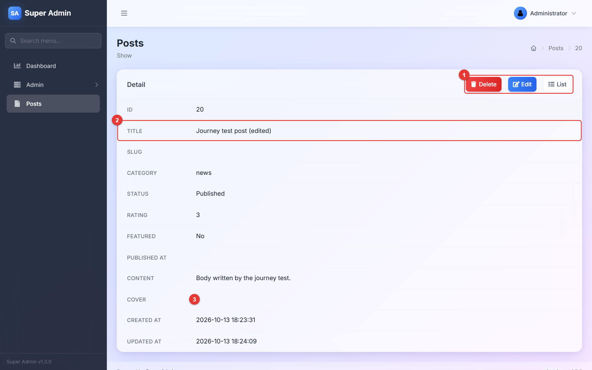

*The detail page of a post*

| # | What it is | Where it takes you |
| --- | --- | --- |
| 1 | **Tools** – **Delete**, **Edit** and **List**. | Edit opens the form; List goes back. |
| 2 | **Field rows** – label and value. Chips, images and links are shown as such. | Links open in a new tab. |
| 3 | **Image** – stored images are shown as a thumbnail. | — |

## 10. For administrators

This section is for the **administrator** role (and anyone with the *Auth management* permission). Your extra pages sit under **Admin** in the menu: Users, Roles, Permission, Menu and Operation log. They are ordinary list pages (section 5) with the forms described below.

**Your first editor in four steps**

1. Open **Admin → Permission → New** and create what the editor may do: slug `posts-manage`, name *Manage posts*, HTTP path `/` on the first line and `/posts*` on the second (the dashboard and everything under posts). Leave HTTP method empty for all methods, or pick GET only for a read-only role.
2. Open **Admin → Roles → New**: slug `editor`, name *Editor*, move *Manage posts* to the selected list, **Submit**.
3. Open **Admin → Users → New**: username, name, password twice, role *Editor*, **Submit**.
4. Sign out, sign in as the new user: the menu shows only Dashboard and Posts, and any other address answers *Permission denied* (last picture of this section).

### 10.1 Users

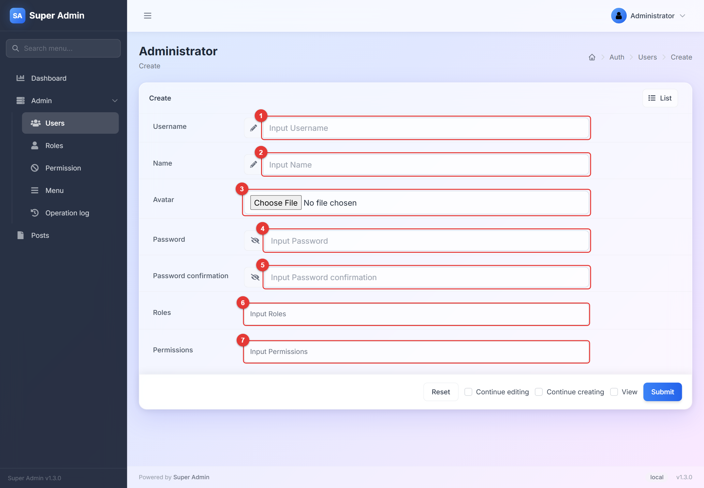

*Admin → Users → New*

| # | What it is |
| --- | --- |
| 1 | **Username** – what the person types to sign in. Must be unique. |
| 2 | **Name** – shown in the top bar and in the operation log. |
| 3 | **Avatar** – optional picture; without one the default avatar is used. |
| 4 | **Password** – at least the length set by the developer (6 characters by default). |
| 5 | **Password confirmation** – the same again. On an edit form, leave both unchanged to keep the current password. |
| 6 | **Roles** – one or more roles. Permissions come from the roles. |
| 7 | **Permissions** – extra permissions given to this user directly, on top of the roles. |

### 10.2 Roles

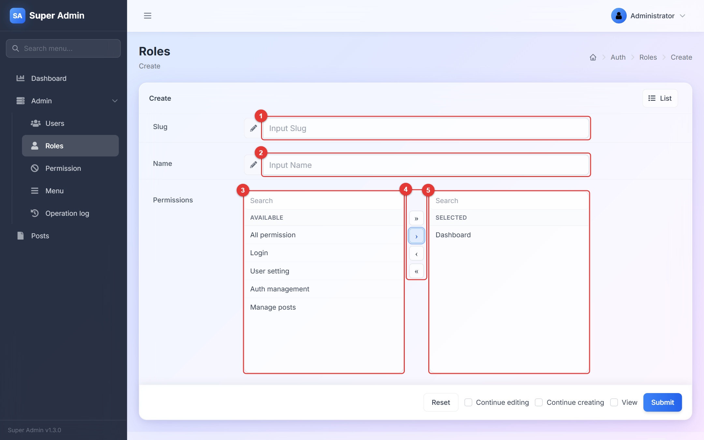

*Admin → Roles → New, with one permission moved to the selected list*

| # | What it is |
| --- | --- |
| 1 | **Slug** – the technical name, lowercase, no spaces (`editor`). Code and menu items refer to it. |
| 2 | **Name** – what people see (*Editor*). |
| 3 | **Available** – every permission that exists. The search box filters the list. |
| 4 | **Move buttons** – `>` moves the highlighted permission to the right, `»` moves all; `<` and `«` take them back. |
| 5 | **Selected** – the permissions of this role. |

### 10.3 Permissions

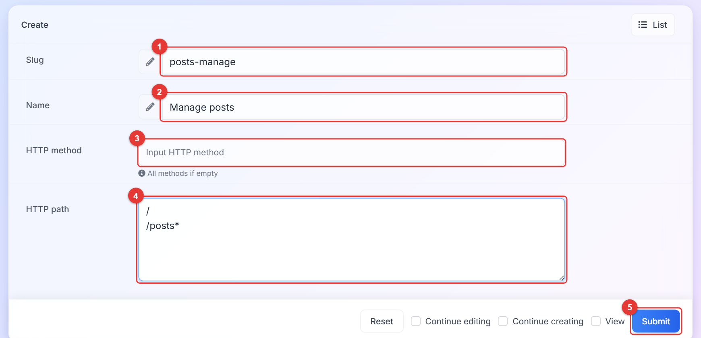

*Admin → Permission → New*

| # | What it is |
| --- | --- |
| 1 | **Slug** – technical name (`posts-manage`), unique. |
| 2 | **Name** – what people see. |
| 3 | **HTTP method** – which actions: leave empty for all, choose GET for read only, or POST/PUT/DELETE for writing. |
| 4 | **HTTP path** – one path per line, relative to the panel, **starting with a slash**: `/` is the dashboard, `/posts*` is the posts list, its create/edit/show pages and its actions, `/auth/*` is everything under Admin. A method can be written in front of a path, for example `GET:/reports*`. |
| 5 | **Submit** – saves the permission. Nothing changes for users until the permission is added to a role or a user. |

| You want a role that… | HTTP method | HTTP path |
| --- | --- | --- |
| can open everything | (empty) | `*` |
| manages posts and sees the dashboard | (empty) | `/` and `/posts*` |
| can only read posts | GET | `/` and `/posts*` |
| can read posts and export them | GET | `/`, `/posts*` (export is a GET) |
| manages users, roles, permissions and the menu | (empty) | `/auth/*` |

> **Remember:** Paths without a leading slash (`posts*`) do not match. The built-in permissions (*All permission*, *Dashboard*, *Login*, *User setting*, *Auth management*) show the format.

### 10.4 Menu

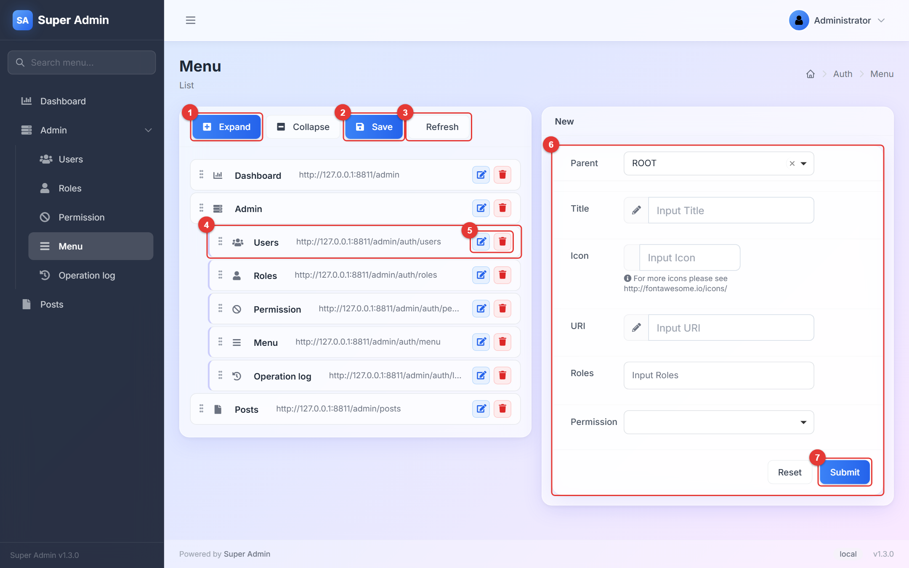

*Admin → Menu: the tree on the left, the form for a new item on the right*

| # | What it is | Where it takes you |
| --- | --- | --- |
| 1 | **Expand / Collapse** – open or close all groups in the tree. | — |
| 2 | **Save** – saves the order and nesting after you dragged items. | A *Save succeeded* toast; the sidebar updates. |
| 3 | **Refresh** – reloads the tree without saving. | — |
| 4 | **Item** – drag the dotted handle to move it; drop it under another item to nest it. The link shows where it goes. | — |
| 5 | **Edit / Delete** – edit opens the item's form; delete asks for confirmation. | — |
| 6 | **New item** – parent (ROOT for a top-level item), title, icon (a Font Awesome name such as `icon-file`), URI (relative to the panel, for example `posts`; a full `https://…` address opens in a new tab), roles that may see it, and an optional permission it is bound to. | — |
| 7 | **Submit** – adds the item at the end of its parent. | The tree and the sidebar show it at once. |

> **Tip:** A menu item only shows the page; the permission decides whether the page opens. Give the role both, or the user gets *Permission denied* after clicking.

### 10.5 Operation log

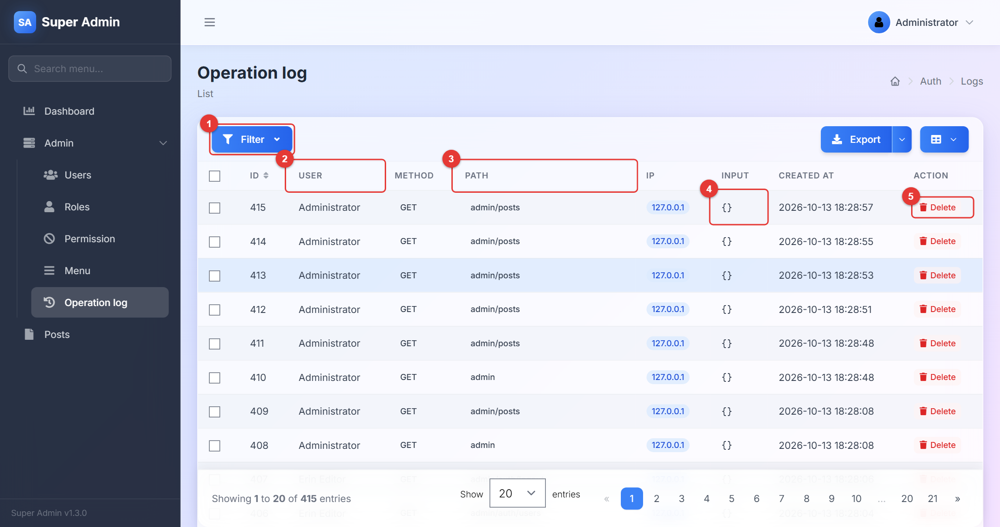

*Admin → Operation log*

| # | What it is |
| --- | --- |
| 1 | **Filter** – by user, method, path or IP; the filter fields open under the toolbar. |
| 2 | **User** – who made the request. |
| 3 | **Path** – the page or action, for example `admin/posts/3/edit`. |
| 4 | **Input** – what was sent, as JSON. Passwords and tokens are replaced by stars. |
| 5 | **Delete** – removes one entry; tick rows and use the batch menu to clear many. |

Every request to the panel is logged, including page views, unless the developer excluded a path. The log can be switched off in the configuration.

### 10.6 Your own account

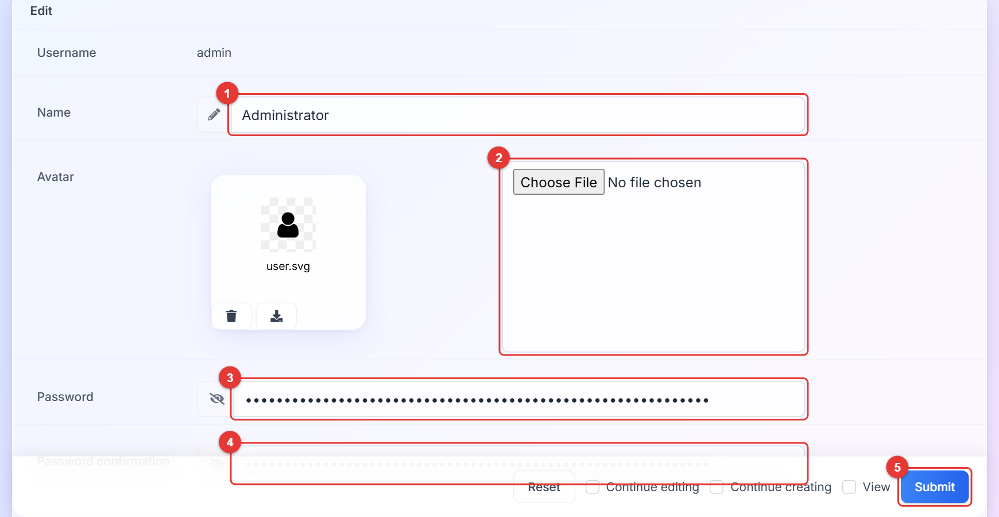

*User menu → Setting*

| # | What it is |
| --- | --- |
| 1 | **Name** – shown in the top bar. |
| 2 | **Avatar** – upload a picture. |
| 3 | **Password** – a new password; leave empty to keep the current one. |
| 4 | **Password confirmation** – the same again. |
| 5 | **Submit** – saves; an *Update succeeded* toast confirms. |

### 10.7 What a limited user sees

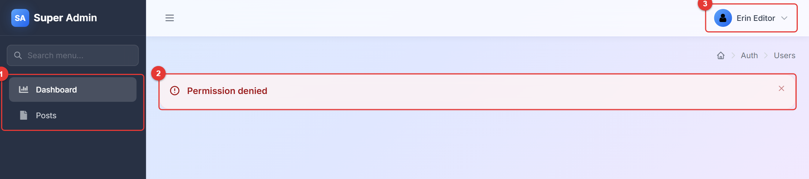

*The editor created above, after opening Admin → Users by typing the address*

| # | What it is |
| --- | --- |
| 1 | **Menu** – only Dashboard and Posts: the Admin group is hidden because the role has no permission for `/auth/*`. |
| 2 | **Permission denied** – the answer to any page outside the role's paths. Nothing was changed. |
| 3 | **User menu** – Setting and Logout are always available. |

## 11. For developers

This section is for the person who builds the pages. The whole panel comes from one package; you write a controller per resource and the list, form and detail pages in sections 5 – 9 appear. The reference is `docs/user-manual.md` (sections 7 – 11); this section shows the journeys.

**Your first page in four steps**

1. Create the model and table: `php artisan make:model Post -m`, write the migration, `php artisan migrate`.
2. Generate the controller: `php artisan admin:controller \App\Models\Post --title=Posts`. It lands in `app/Admin/Controllers/PostController.php` with a `grid()`, a `form()` and a `detail()` method.
3. Register the route in `app/Admin/routes.php`: `$router->resource('posts', PostController::class);`
4. Add the menu item: **Admin → Menu → New**, title *Posts*, icon `icon-file`, URI `posts`. Open it.

The generated controller already gives every column and field a sensible default. Then tune it:

```php
protected function grid(): Grid
{
    $grid = new Grid(new Post);

    $grid->column('id', 'ID')->sortable();
    $grid->column('title')->editable();                                   // section 8, picture 1
    $grid->column('category')->label(['news' => 'primary', 'tutorial' => 'success']);
    $grid->column('status')->using([0 => 'Draft', 1 => 'Published'])->dot([0 => 'warning', 1 => 'success']);
    $grid->column('is_featured', 'Featured')->switch();                   // section 8, picture 1, mark 4
    $grid->column('published_at')->sortable();
    $grid->column('created_at')->dateFormat('Y-m-d H:i');

    $grid->quickSearch('title');                                          // section 5, mark 3
    $grid->filter(function (Grid\Filter $filter) {                        // section 6
        $filter->like('title');
        $filter->equal('category')->select(['news' => 'News', 'tutorial' => 'Tutorial']);
        $filter->between('published_at')->datetime();
    });

    return $grid;
}
```

```php
protected function form(): Form
{
    $form = new Form(new Post);

    $form->tab('Basic', function (Form $form) {                           // section 7, mark 1
        $form->text('title')->rules('required|max:120');                  // mark 2 (asterisk) and the validation picture
        $form->text('slug')->help('Leave empty to generate from the title.'); // mark 3
        $form->select('category')->options(['news' => 'News', 'tutorial' => 'Tutorial']); // mark 4
        $form->switch('is_featured', 'Featured');                         // mark 5
        $form->datetime('published_at');
    })->tab('Content', function (Form $form) {
        $form->textarea('content')->rows(8);
        $form->image('cover');                                            // the upload picture
    });

    return $form;
}
```

**Journeys you will repeat**

| You want to… | Where | Code |
| --- | --- | --- |
| Add a column | `grid()` | `$grid->column('price')->sortable();` |
| Show a related name | `grid()` | `$grid->column('author.name', 'Author');` |
| Add a filter | `grid()` → `filter()` | `$filter->equal('author_id')->select(Author::pluck('name', 'id'));` |
| Add a field | `form()` | `$form->number('price')->min(0);` |
| Make a field required | `form()` | `->rules('required')` |
| Upload a file | `form()` | `$form->file('attachment')->move('attachments');` |
| Pick a related record | `form()` | `$form->select('author_id')->options(Author::pluck('name', 'id'));` |
| Many related records | `form()` | `$form->multipleSelect('tags')->options(Tag::pluck('name', 'id'));` |
| Nested rows (order lines) | `form()` | `$form->hasMany('lines', fn (Form\NestedForm $f) => $f->text('sku'));` |
| Show or hide fields by a value | `form()` | `->when(1, fn (Form $f) => $f->text('company'))`, `->whenIn([…])`, `->whenNot(…)` |
| Do something before saving | `form()` | `$form->saving(function (Form $form) { … });` |
| Add a row action ("Publish") | a `RowAction` class, then `$grid->actions(fn ($a) => $a->add(new Publish));` | see below |
| Add a batch action | a `BatchAction` class, then `$grid->batchActions(fn ($b) => $b->add(new Archive));` | see below |
| Hide a default tool | `grid()` | `$grid->disableExport();`, `disableCreateButton()`, `disableRowSelector()`, `disableDefaults()` |
| Change the detail page | `detail($id)` | `$show->field('cover')->image();`, `$show->comments('Comments', fn ($c) => $c->field('body'));` |
| Add a dashboard card | `HomeController::index()` | `$row->column(4, new InfoBox('Orders', 'shopping-cart', 'aqua', '/admin/orders', '1,284'));` |
| Brand the panel | `config/admin.php` | `name`, `logo`, `logo-mini`, `title`, `login_background_image` |
| Add a navbar link, CSS or JS | `app/Admin/bootstrap.php` | `Admin::navbar(fn (Navbar $n) => $n->left('<a href="/">Site</a>'));`, `Admin::css('/css/x.css');` |
| Switch the look | Admin > Templates | Click **Activate** on a template card (or `php artisan admin:template bootstrap-classic`; default in `config/admin.php`) |

A row action and a batch action:

```php
use SuperAdmin\Admin\Actions\RowAction;
use SuperAdmin\Admin\Actions\BatchAction;

class Publish extends RowAction
{
    public $name = 'Publish';

    public function handle()
    {
        $this->getModel()->update(['status' => 1]);

        return $this->response()->success('Published')->refresh();
    }

    public function dialog()
    {
        $this->confirm('Publish this post?');
    }
}

class Archive extends BatchAction
{
    public $name = 'Archive selected';

    public function handle()
    {
        foreach ($this->getModels() as $post) {
            $post->update(['status' => 2]);
        }

        return $this->response()->success('Archived')->refresh();
    }
}
```

**Testing what you built.** The panel's own test style is BrowserKit with Pest: sign in with `$this->be(Administrator::first(), 'admin')`, then `$this->visit('admin/posts')->see('Posts')`, `->submitForm('Submit', ['title' => 'Hello'])->seePageIs('admin/posts')`. The package's suite (819 tests) is a catalogue of examples: `vendor/super-admin-org/super-admin/tests/Feature`.

> **Tip:** Keep the generated structure: one controller per resource, routes in `app/Admin/routes.php`, assets and navbar in `app/Admin/bootstrap.php`. Everything in this guide assumes it, and so does `php artisan admin:*`.

> **Remember:** Permission paths are matched against the route, so a resource registered as `posts` is protected by `/posts*`. Name routes consistently and the permissions stay simple.

## 12. For the project team

**Install (10 minutes).** `composer require super-admin-org/super-admin`, publish with `php artisan vendor:publish --provider="SuperAdmin\Admin\AdminServiceProvider"`, add the `admin` disk to `config/filesystems.php` (the manual's installation section shows it), run `php artisan admin:install`, open `/admin`, sign in with **admin / admin**, change the password.

**Test accounts.** The installer creates one user, `admin` (role *administrator*). For acceptance tests create one user per role as in section 10 (the demo used `editor1` with the *Editor* role) and keep the list in your test plan. Never test with the administrator account only: it skips every permission check.

**Update.** `composer update super-admin-org/super-admin`, then `php artisan vendor:publish --tag=super-admin-assets --force` and `php artisan view:clear`. Skipping the second command is the usual cause of a broken-looking panel after an update.

**Deployment checklist.**

- [ ] `APP_URL` matches the address users type (uploads are linked from it).
- [ ] `ADMIN_HTTPS=true` behind a TLS proxy.
- [ ] The `admin` disk points to a writable folder that the web server serves (`public/uploads`).
- [ ] `php artisan config:cache` and `view:cache` after the deploy; `view:clear` after a template switch.
- [ ] The default password is changed and `auth.throttle_logins` is on.
- [ ] Operation log enabled (or deliberately disabled in `config/admin.php`).
- [ ] Assets published (`public/vendor/super-admin` exists and is current).

**Test report for this guide.** Every journey in sections 3 – 10 was run in a browser against the demo copy (Laravel 13, PHP 8.3, SQLite, Tailwind Light template) with an automated script, and the package's suite (819 tests) passed. Two defects found while writing were fixed in the package:

| Found in | Symptom | Fix |
| --- | --- | --- |
| Section 8, batch delete | Rows were deleted but the list did not refresh and an error was logged for every batch delete (*Action method BatchDelete::handle() does not exist*) | Built-in batch actions no longer register the generic action handler next to their own script |
| Section 10.4, menu | A new or moved menu item appeared in the tree but not in the sidebar until a full page reload | The sidebar re-renders after any change on the menu page |

Both are in the CHANGELOG for 1.3.0.

## 13. Common questions

| Question | Answer |
| --- | --- |
| I signed in but the menu is almost empty. | Your roles have few permissions, or the menu items are limited to other roles. Ask the administrator (section 10). |
| A page says *Permission denied*. | Your role lacks a permission whose path covers that page. The administrator adds it (section 10.3); paths start with a slash. |
| The list shows fewer rows than I expect. | A filter, a quick search or a page size is active; look at the address bar and press **Reset** in the filter panel. |
| Some columns disappeared. | You hid them with the column selector; open it and press **All**. |
| My change in the form was not saved. | You left the page before **Submit**, or a field had an error (red marker on a tab). |
| The export is empty or partial. | The export follows the current filter; clear it first, and choose *All* in the Export menu. |
| The new menu item does not open. | Give the role a permission for the item's path, or bind the item to a permission that the role has. |
| I cannot delete a record. | Your role may not have DELETE in its permission's HTTP methods, or the record is protected by the developer's code (a toast says why). |
| Uploaded images do not show. | The `admin` disk or `APP_URL` is wrong (project team, section 12). |
| The panel looks unstyled after an update. | Assets not republished (section 12, *Update*). |
| Can I use the panel on a phone? | Yes; the sidebar slides in from the menu button, tables scroll sideways, forms stack. |
| Where is the audit trail? | **Admin → Operation log** (section 10.5). |

## 14. Tips collected

> **Tip:** The menu search is the fastest way around: two or three letters and Enter.

> **Tip:** Everything you did to a list (search, filter, sort, page) is in the address bar; bookmark it or send it to a colleague who has the same rights.

> **Tip:** *Continue creating* saves a trip back to the list when you enter many records.

> **Tip:** Export after filtering to get exactly the rows you need in a spreadsheet.

> **Remember:** Only pages your roles allow are listed, and the administrator role bypasses every check; test with a real role before going live.

> **Remember:** Permission paths start with a slash and may end with `*`; `GET:` in front limits them to reading.

> **Remember:** Deletions are final unless the developer enabled soft deletes; the operation log keeps who and when, not the data.

> **Remember:** After an update, republish the assets and clear the view cache; after a template switch, clear the view cache.
