# Super Admin – User Manual and Developer Guide

Version 1.3.0 · October 2026 · Package `super-admin-org/super-admin` · MIT licence

Super Admin is an administrative interface builder for Laravel. You describe a grid, a form, a detail page or a tree in PHP, and the package renders a complete admin panel around it: authentication, roles and permissions, a sidebar menu editor, an operation log, file uploads, exports, and two UI templates (Tailwind Light and Classic Bootstrap 5).

This document is written for two readers:

- **Administrators** who use a panel built with Super Admin (sections 5 to 7).
- **Developers** who install the package and build pages with it (sections 2 to 4 and 8 to 12).

Screenshots are from the Tailwind Light template unless marked Classic. Every page shown exists in both templates.

---

## 1. History of the code base

Super Admin continues a line of Laravel admin builders that started in 2016.

| When | What | Notes |
| --- | --- | --- |
| 2016–2021 | **laravel-admin** by z-song | The original builder: Grid, Form, Show, Tree, RBAC, extensions. Built on AdminLTE / Bootstrap 3 and jQuery. Development stopped around Laravel 9. |
| 2021–2023 | **open-admin** (open-admin-org) | A fork that removed jQuery and AdminLTE, rebuilt the front end on Bootstrap 5 with plain JavaScript and PJAX page loads, kept the PHP API. Stopped before Laravel 11. |
| May 2025 | **super-admin** forked | New repository `super-admin-org/super-admin` by Talemul Islam. Goal: keep the laravel-admin / open-admin API working on current Laravel and PHP. First commits 24–25 May 2025. |
| Jun 2025 | v1.0.0, v1.1.0 | Laravel 10/11/12 support, PHP 8.2+, Pest test suite, GitHub Actions matrix. |
| Aug 2025 | v1.1.2 – v1.1.6 | First public release on Packagist (changelog entry 11 Aug 2025), documentation set (28 pages), 23 translations. |
| Sep 2025 | v1.1.7 – v1.1.10 | Laravel 13 support, bug fixes, code-style automation. |
| Mar 2026 | v1.2.0, v1.2.1 | Last release on the single Bootstrap template. |
| Mar–Oct 2026 | `template` branch | Template system: views can live in `resources/views/<template>/` with fallback to the root views; new **Tailwind Light** template (Tailwind CSS 3.4, Vite build, no Bootstrap JS); the old views kept as **super-admin-template-1**. 32 commits. |
| Oct 2026 | **v1.3.0** | Template release. 24 bugs fixed (see section 13), the test suite runs to completion again (819 tests), this manual. |

### 1.1 What is in the repository

```
src/                      PHP source (~39,000 lines)
  Admin.php               Service: builders, menu, user, navbar, assets, routes
  AdminServiceProvider    Registers views (template aware), middleware, commands, publishing
  Grid.php, Grid/         Data tables: 35 column displayers, 21 filter types, exporters, tools
  Form.php, Form/         Forms: 59 field types, tabs/rows, uploads, nested forms, cascades
  Show.php, Show/         Detail pages: fields, panels, relations
  Tree.php, Tree/         Nested, drag-and-drop lists
  Actions/                Row, batch and standalone actions with toast / dialog responses
  Auth/                   Administrator, Role, Permission, Menu, OperationLog models; RBAC checks
  Controllers/            Built-in pages (users, roles, permissions, menu, logs, auth, dashboard)
  Middleware/             admin.auth, admin.permission, admin.log, admin.pjax, admin.bootstrap, admin.throttle
  Widgets/                Box, InfoBox, Tab, Table, Alert, Callout, Collapse, Carousel, Form, StepForm, Navbar
  Console/                19 artisan commands (install, make, controller, menu, user, extension, ...)
  Layout/                 Content, Row, Column (page composition)
  Traits/HasAssets        CSS/JS registration, template-aware base assets
resources/views/          Classic (Bootstrap 5) views = fallback for every template
resources/views/tailwind-light/        Tailwind Light template (138 Blade files)
resources/views/super-admin-template-1/ Copy of the classic views, selectable by name
resources/assets/         Vendor libraries (axios, flatpickr, choices.js, sortable, sweetalert2, toastify, nprogress, Font Awesome, dual-listbox) and the compiled bundles
resources/lang/           23 languages
config/admin.php          Published configuration
database/migrations/      Admin tables
docs/                     This manual and 28 reference pages
tests/                    Pest suite (BrowserKit), 819 tests
```

### 1.2 Design in one paragraph

A controller extends `AdminController` and returns a `Grid`, `Form` or `Show` built with a fluent PHP API. Each builder renders Blade views from the active template; the shared JavaScript (`admin.*` namespace) loads pages over PJAX, submits forms, handles inline edits, actions and toasts. All data access goes through Eloquent, so relations, scopes and accessors work as they do in the rest of the application. Authentication uses a dedicated `admin` guard and its own tables (`admin_users`, `admin_roles`, `admin_permissions`, `admin_menu`, `admin_operation_log`), so the admin panel never mixes with the application's users.

---

## 2. Requirements and compatibility

| Requirement | Supported |
| --- | --- |
| PHP | 8.0, 8.1, 8.2, 8.3, 8.4 |
| Laravel | 8.x and 9.x (end-of-life, see below), 10.x, 11.x, 12.x, 13.x |
| Database | Anything Eloquent supports (MySQL, MariaDB, PostgreSQL, SQLite, SQL Server) |
| Browser | Current Chrome, Edge, Firefox, Safari (the Tailwind template uses `backdrop-filter` and `:has()`) |
| Node.js | Not required at runtime; only to rebuild the Tailwind template |

| Laravel | PHP | Status in 1.3.0 |
| --- | --- | --- |
| 13 | 8.3, 8.4 | Supported, in CI |
| 12 | 8.2, 8.3, 8.4 | Supported, in CI |
| 11 | 8.2, 8.3, 8.4 | Supported, in CI |
| 10 | 8.2, 8.3 | Supported, in CI |
| 9 | 8.0, 8.1, 8.2 | Supported, in CI; verified with the full suite and browser checks on PHP 8.1 |
| 8 | 8.0, 8.1 | Supported, in CI; verified with the full suite and browser checks on PHP 8.0 |
| 4, 5, 6, 7 | 5.3 – 8.0 | Not supported |

**Laravel 8 and 9 are end-of-life.** Both have published security advisories, and Composer 2.8 or newer refuses to install them unless you set `composer config audit.block-insecure false` in the application. Use them only for existing applications that cannot be upgraded yet, and plan the upgrade.

**Why Laravel 4 to 7 cannot be supported.** They run on PHP 5.3 to 8.0 and lack the framework APIs the package is built on: Laravel 4 has no middleware, no namespaced service-provider resource loading and no package discovery; Laravel 5 to 7 predate the PHP 8 syntax used throughout the package (union and nullable types, typed properties) and the Symfony 5.4+ components it depends on. Supporting them would mean rewriting the package for those PHP versions, with no security updates on either side. Upgrade the application first (the Laravel upgrade guides or Laravel Shift), then install Super Admin.

---

## 3. Installation

A fresh install takes four commands and one config edit.

```bash
composer require super-admin-org/super-admin
php artisan vendor:publish --provider="SuperAdmin\Admin\AdminServiceProvider"
```

Add the upload disk the package expects to `config/filesystems.php` (image and file fields fail with *Disk [admin] not configured* without it):

```php
'disks' => [
    // ...
    'admin' => [
        'driver' => 'local',
        'root' => public_path('uploads'),
        'visibility' => 'public',
        'url' => env('APP_URL').'/uploads',
    ],
],
```

Run the installer. It migrates the admin tables, seeds the default user, role, permissions and menu, and creates `app/Admin` with `routes.php`, `bootstrap.php`, a `HomeController` and an `AuthController`:

```bash
php artisan admin:install
```

Open `http://your-app.test/admin` and sign in with **admin / admin**. Change the password from the user menu (top right) → **Setting** before the panel is reachable by anyone else.

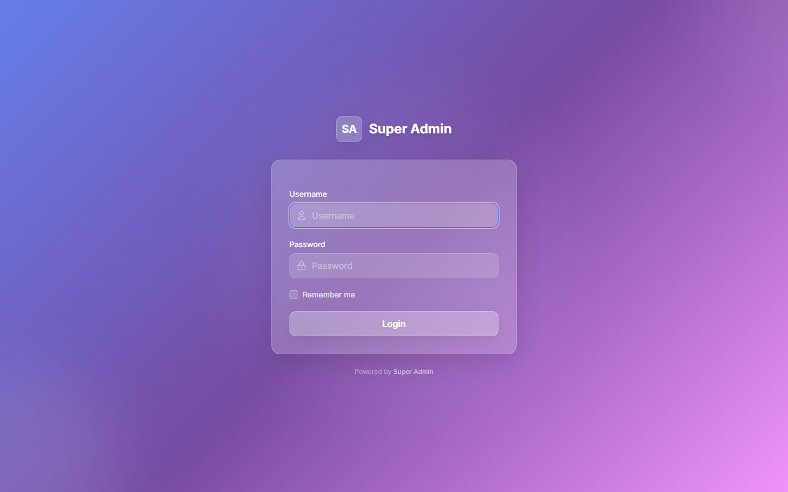

### 3.1 Updating

```bash
composer update super-admin-org/super-admin
php artisan vendor:publish --tag=super-admin-assets --force
php artisan view:clear
```

The second command keeps the compiled CSS and JavaScript in `public/vendor/super-admin` in sync with the package; most "the page looks broken after update" reports are a missing re-publish.

### 3.2 Moving from laravel-admin or open-admin

The PHP API is the same; change the namespace from `Encore\Admin` / `OpenAdmin\Admin` to `SuperAdmin\Admin`, the config file name stays `config/admin.php`, and the table names are unchanged. Views you had overridden under `resources/views/vendor/admin` need to be checked against the new templates. See `docs/upgrading.md` for the step list.

---

## 4. Configuration

All settings live in `config/admin.php`. After editing run `php artisan config:clear` and `php artisan view:clear`.

| Key | Default | Purpose |
| --- | --- | --- |
| `name` | `Super Admin` | Name on the login page |
| `logo`, `logo-mini` | `<b>Super</b> Admin`, `<b>SA</b>` | Sidebar brand (full / collapsed); may be an `` tag |
| `template` | `tailwind-light` | `tailwind-light` or `super-admin-template-1` (Classic) |
| `title` | `Admin` | HTML title prefix |
| `route.prefix` | `admin` (`ADMIN_ROUTE_PREFIX`) | URL prefix; empty string serves the panel at the site root |
| `route.namespace` | `App\Admin\Controllers` | Controller namespace for `app/Admin/routes.php` |
| `route.middleware` | `['web', 'admin']` | `admin` = auth, throttle, pjax, log, bootstrap, permission |
| `directory` | `app/Admin` | Where `admin:install` and generators write files |
| `auth.guard`, `auth.guards`, `auth.providers` | `admin` guard, Eloquent `Administrator` provider | Separate auth stack for the panel |
| `auth.remember` | `true` | "Remember me" on the login form |
| `auth.redirect_to` | `auth/login` | Where guests are sent; always reachable |
| `auth.throttle_logins`, `throttle_attempts`, `throttle_timeout` | `true`, 5, 900 | Brute-force protection |
| `auth.excepts` | `auth/login`, `auth/logout` | Paths that skip authentication |
| `upload.disk`, `upload.directory` | `admin`, `images` / `files` | Disk and sub-folders for uploads |
| `database.*` | `admin_*` tables, built-in models | Connection, table and model names |
| `operation_log.enable`, `allowed_methods`, `except`, `filter_input` | on, all methods, `admin/auth/logs*`, passwords | Request logging |
| `check_route_permission`, `check_menu_roles` | `true` | Enforce permissions on routes; hide menu items by role |
| `default_avatar` | `/vendor/super-admin/super-admin/gfx/user.svg` | Avatar when none is uploaded |
| `map_provider` | `openstreetmaps` | `openstreetmaps`, `google`, `tencent`, `yandex` for the map field |
| `login_background_image` | `''` | Image URL for the login page background |
| `show_version`, `show_environment` | `true` | Footer badges |
| `menu_bind_permission` | `true` | Menu items can require a permission |
| `enable_default_breadcrumb` | `true` | Breadcrumb from the URL when a page sets none |
| `enable_menu_search` | `true` | Search box above the menu |
| `enable_user_panel` | `false` | User card in the sidebar |
| `top_alert` | `''` | HTML banner on every page |
| `grid_action_class` | `Actions::class` | Row actions as buttons, `DropdownActions::class` or `ContextMenuActions::class` |
| `minify_assets` | `['excepts' => []]` | For `php artisan admin:minify` |
| `extension_dir`, `extensions` | `app/Admin/Extensions`, `[]` | Extension scaffolding and settings |
| `skin`, `layout` | — | Classic template only |

Environment variables read by the config: `ADMIN_ROUTE_PREFIX`, `ADMIN_HTTPS` (force `https` URLs behind a TLS proxy).

---

## 5. Templates

Set `'template'` in the config; nothing else changes.

| Template | Config value | Stack | Looks |
| --- | --- | --- | --- |
| Tailwind Light (default) | `tailwind-light` | Tailwind CSS 3.4, Inter font, frosted-glass cards, dark sidebar, no Bootstrap JS | 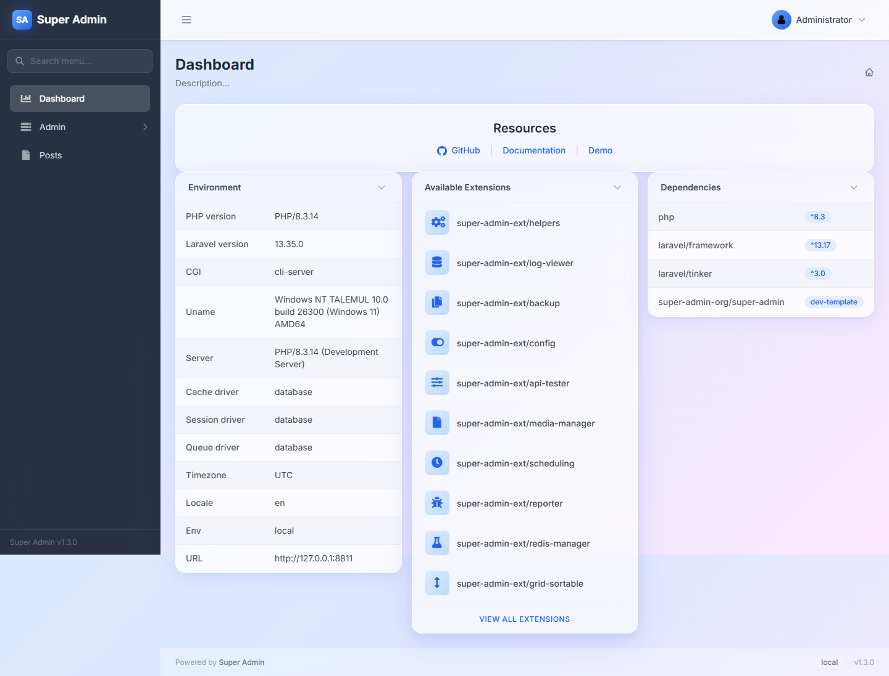 |
| Classic | `super-admin-template-1` | Bootstrap 5, white cards | 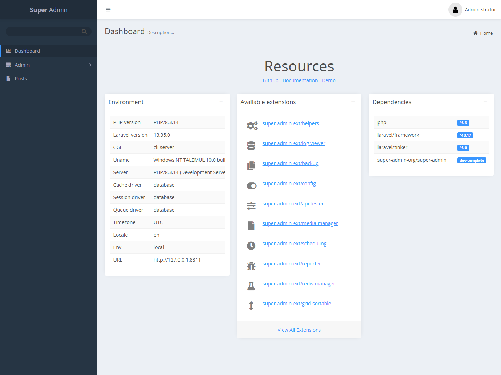 |

**Resolution order.** Views are loaded from `resources/views/vendor/admin/` in your application first, then from the template directory, then from the package's root views (the Classic markup). A template only needs the files it changes.

**Tailwind Light layout.** Fixed dark sidebar with menu search and a collapse toggle (desktop), sticky header with the user menu, content cards. Grid paginators and form footers are sticky, so Submit and the page controls stay visible while scrolling. On phones the sidebar slides over the page.

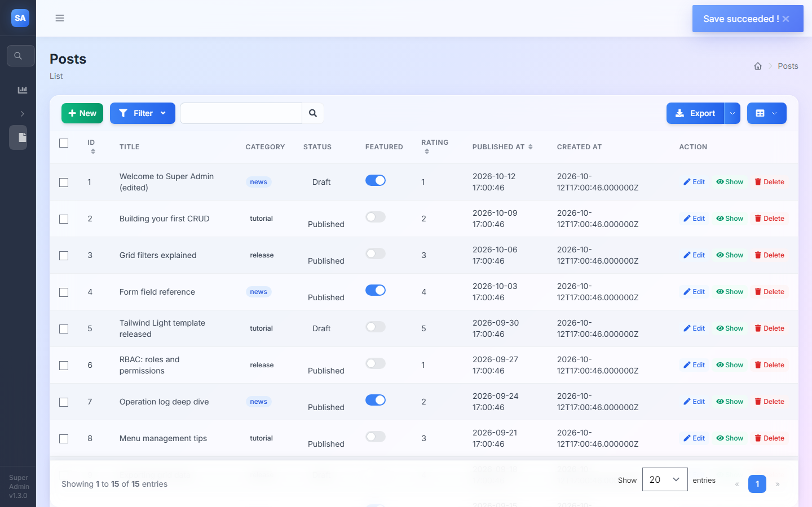

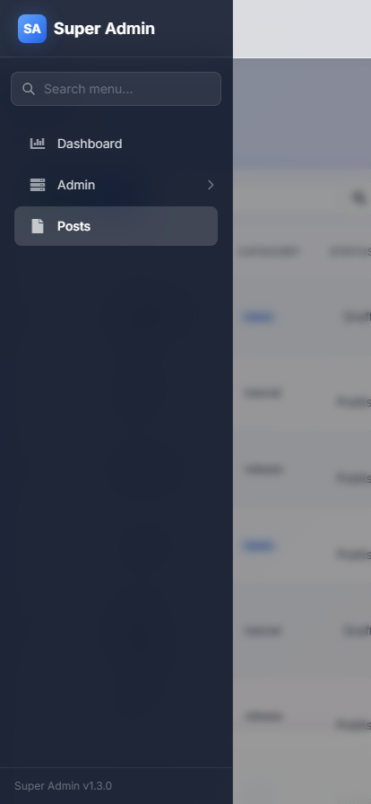

**JavaScript.** Both templates share the same scripts (`admin.ajax`, `admin.grid`, `admin.form`, `admin.toastr`, `admin.selectable`). Tailwind Light does not load Bootstrap; its bundle provides `window.bootstrap` with `Modal`, `Popover`, `Tooltip`, `Tab`, `Collapse` and `Dropdown` classes implementing the subset the panel uses, and it accepts both `data-sa-*` and `data-bs-*` attributes. Custom Blade written for the Classic template keeps working after a switch.

Clear the view cache after switching: `php artisan view:clear`.

---

## 6. Using the panel (administrators)

### 6.1 Signing in and your account

Sign in with your username and password. **Remember me** keeps you signed in on that browser. After five failed attempts the account is locked for 15 minutes. The user menu (top right) has **Setting** (change your name, avatar and password) and **Logout**.

### 6.2 Navigation

The sidebar lists the pages you are allowed to see. Parent items expand on click; the search box filters the menu as you type. On desktop the arrow button in the header collapses the sidebar to icons; on phones the menu button opens it.

### 6.3 Lists (grids)

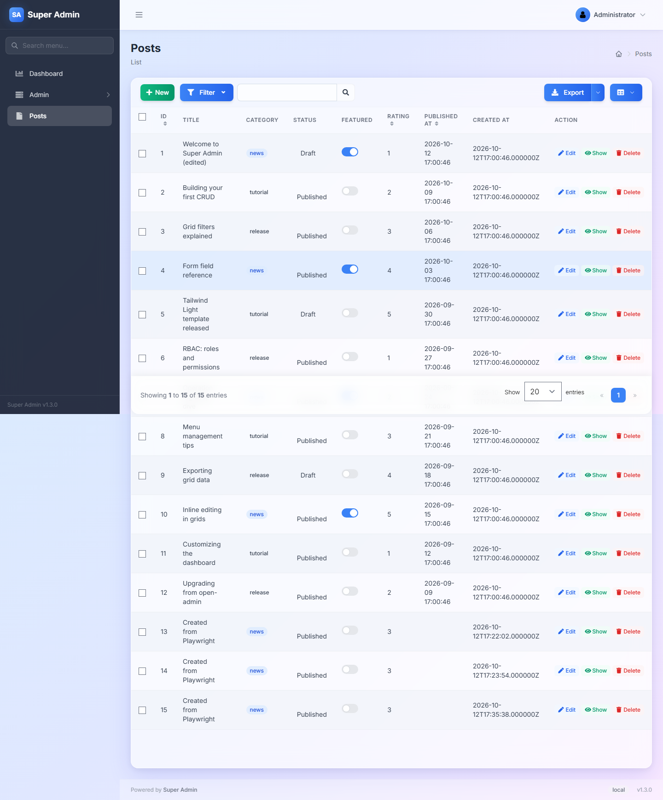

- **New** opens the create form. **Edit**, **Show** and **Delete** act on one row.
- Column headers with arrows sort; click again to reverse.
- **Filter** opens the filter panel; **Search** applies it (the URL changes, so a filtered view can be bookmarked or shared), **Reset** clears it. The quick search box searches the configured columns as you type.
- **Export** downloads a CSV of all rows, the current page, or the selected rows.
- The table icon opens the **column selector**: untick columns to hide them (the choice is remembered in your browser).
- Tick the row checkboxes to reveal the batch actions button (for example delete selected).
- The footer has the row count, the page-size selector and the pager.

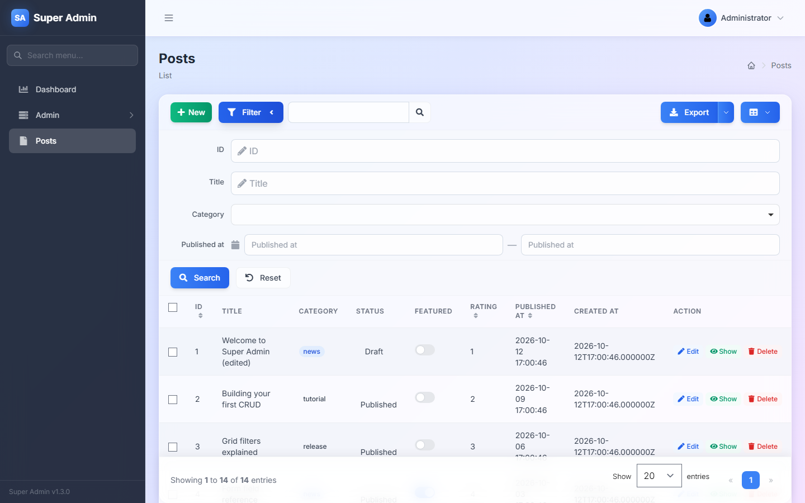

**Inline editing.** Columns marked editable show a pencil on hover. Click the value, change it in the popover and press **Submit**; a toast confirms the save. Switch columns toggle directly.

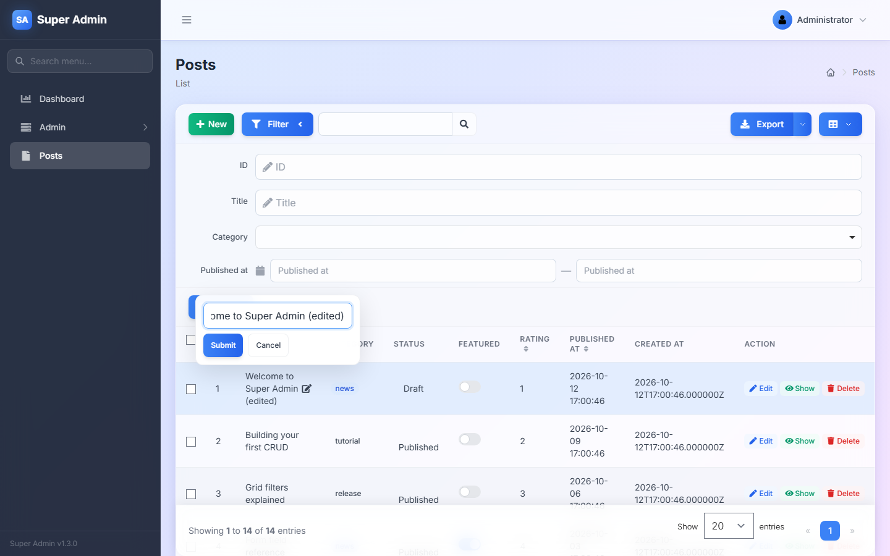

### 6.4 Forms

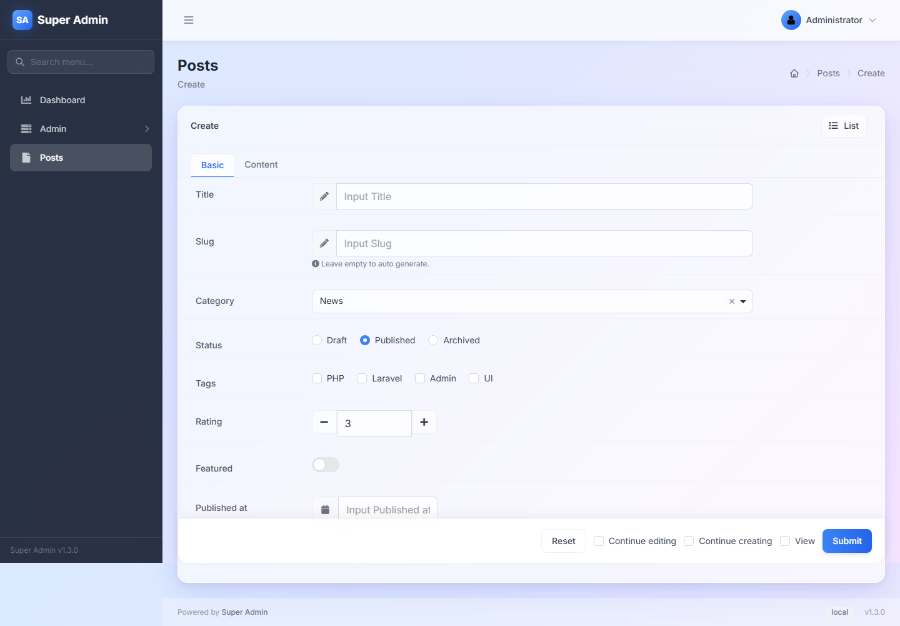

Fields are grouped in tabs when the page defines them; a tab with a validation error gets a red marker. Required fields must be filled before the form sends. The footer has **Reset**, **Submit** and after-save options: *Continue editing*, *Continue creating*, *View*. Image fields show a preview with delete and download buttons.

### 6.5 Detail pages

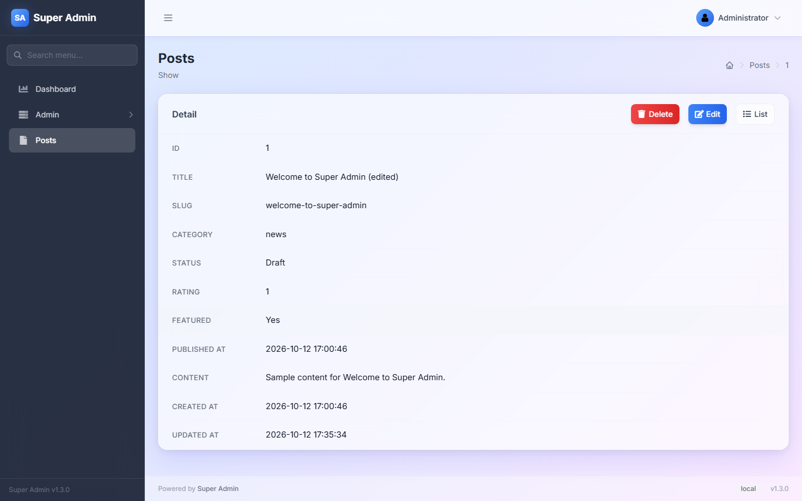

One row per field, with **Edit**, **Delete** and **List** in the header. Related records (for example a post's comments) appear as additional grids below.

### 6.6 Users, roles, permissions

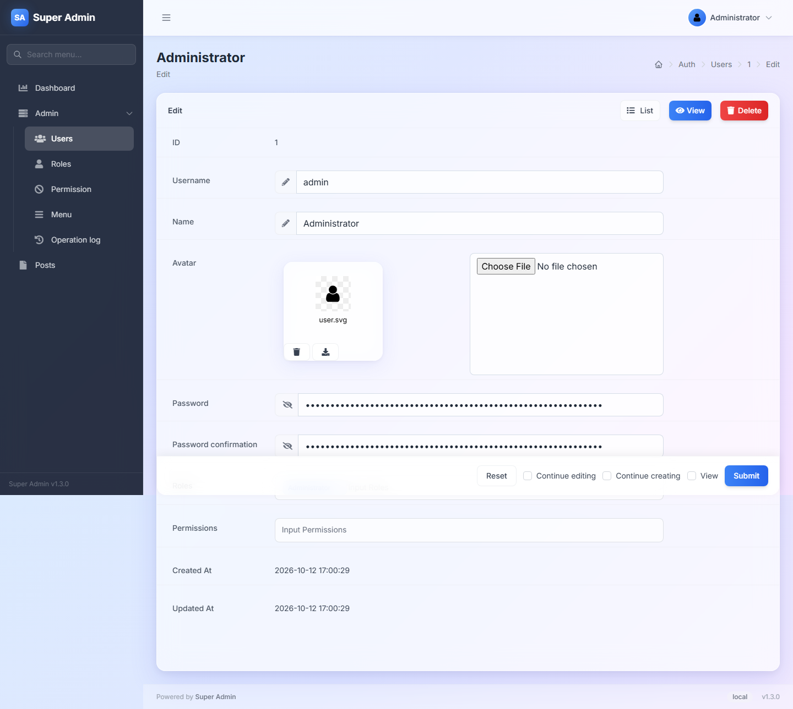

- **Users**: create administrators, set a password, upload an avatar, assign roles and direct permissions.
- **Roles**: a slug, a name and a set of permissions chosen in the dual list box.
- **Permissions**: a name, a slug, the HTTP methods allowed and the route paths covered (`posts*` matches everything under posts; `/` is the dashboard). A user may do something if any of their roles, or their direct permissions, cover the route. The `administrator` role bypasses all checks.

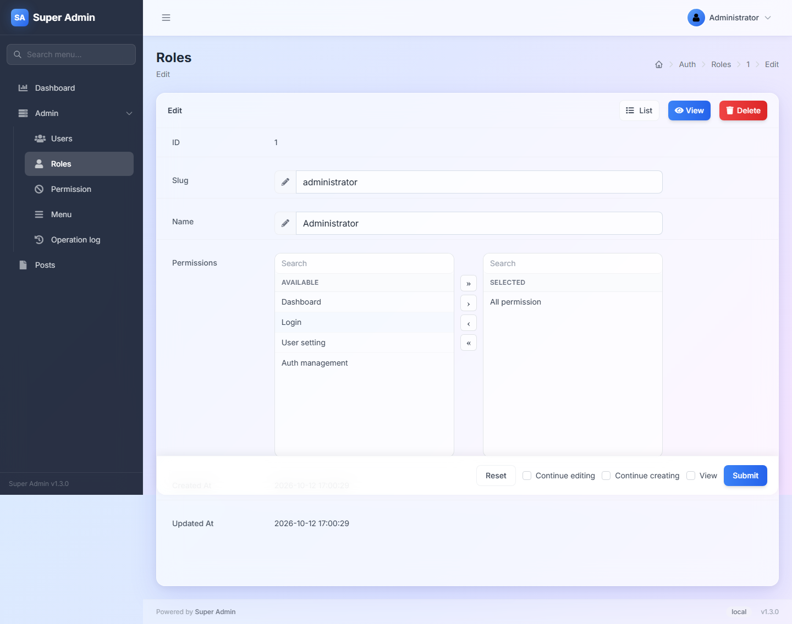

### 6.7 Menu

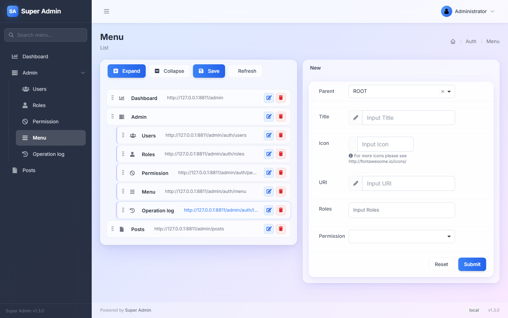

Drag items to reorder or nest them and press **Save**. The form on the right adds an item: parent, title, icon (a Font Awesome name such as `icon-file`), URI (relative to the admin prefix, or a full URL for an external link that opens in a new tab), roles and an optional permission.

### 6.8 Operation log

Every request made in the panel with user, method, path, IP address and input (passwords filtered). Filter by user, method or path; delete entries singly or in batch. Disable logging in the config if your policy requires it.

---

## 7. Developer quick start

After `admin:install` the application has:

```
app/Admin/
  bootstrap.php         Runs on every admin request: register fields, assets, navbar items
  routes.php            Your admin routes (inside the admin prefix and middleware)
  Controllers/
    HomeController.php  Dashboard
    AuthController.php  Login/logout/setting (extends the package controller)
    ExampleController.php
```

### 7.1 A complete resource in four steps

**1. Model and migration**

```bash
php artisan make:model Post -m
```

```php
// database/migrations/xxxx_create_posts_table.php
Schema::create('posts', function (Blueprint $table) {
    $table->id();
    $table->string('title');
    $table->string('slug')->nullable();
    $table->string('category')->default('news');
    $table->unsignedTinyInteger('status')->default(1);
    $table->boolean('is_featured')->default(false);
    $table->dateTime('published_at')->nullable();
    $table->text('content')->nullable();
    $table->string('cover')->nullable();
    $table->timestamps();
});
```

**2. Controller** (generated with `php artisan admin:controller \App\Models\Post`, then edited):

```php
<?php

namespace App\Admin\Controllers;

use App\Models\Post;
use SuperAdmin\Admin\Controllers\AdminController;
use SuperAdmin\Admin\Form;
use SuperAdmin\Admin\Grid;
use SuperAdmin\Admin\Show;

class PostController extends AdminController
{
    protected $title = 'Posts';

    protected function grid(): Grid
    {
        $grid = new Grid(new Post);

        $grid->column('id', 'ID')->sortable();
        $grid->column('title')->editable();
        $grid->column('category')->label(['news' => 'primary', 'tutorial' => 'success', 'release' => 'warning']);
        $grid->column('status')->using([0 => 'Draft', 1 => 'Published', 2 => 'Archived'])
            ->dot([0 => 'warning', 1 => 'success', 2 => 'default']);
        $grid->column('is_featured', 'Featured')->switch();
        $grid->column('published_at')->sortable();

        $grid->quickSearch('title');

        $grid->filter(function (Grid\Filter $filter) {
            $filter->like('title');
            $filter->equal('category')->select(['news' => 'News', 'tutorial' => 'Tutorial', 'release' => 'Release']);
            $filter->between('published_at')->datetime();
        });

        return $grid;
    }

    protected function detail($id): Show
    {
        $show = new Show(Post::findOrFail($id));

        $show->field('id', 'ID');
        $show->field('title');
        $show->field('category');
        $show->field('status')->using([0 => 'Draft', 1 => 'Published', 2 => 'Archived']);
        $show->field('is_featured', 'Featured')->as(fn ($value) => $value ? 'Yes' : 'No');
        $show->field('published_at');
        $show->field('content');
        $show->field('created_at');

        return $show;
    }

    protected function form(): Form
    {
        $form = new Form(new Post);

        $form->tab('Basic', function (Form $form) {
            $form->text('title')->rules('required|max:120');
            $form->text('slug')->help('Leave empty to generate from the title.');
            $form->select('category')->options(['news' => 'News', 'tutorial' => 'Tutorial', 'release' => 'Release'])->default('news');
            $form->radio('status')->options([0 => 'Draft', 1 => 'Published', 2 => 'Archived'])->default(1);
            $form->switch('is_featured', 'Featured');
            $form->datetime('published_at');
        })->tab('Content', function (Form $form) {
            $form->textarea('content')->rows(8);
            $form->image('cover')->help('JPG or PNG');
        });

        $form->saving(function (Form $form) {
            if (! $form->slug) {
                $form->slug = \Illuminate\Support\Str::slug($form->title);
            }
        });

        return $form;
    }
}
```

**3. Route** in `app/Admin/routes.php`:

```php
$router->resource('posts', PostController::class);
```

**4. Menu item**: on the Menu page add *Posts*, icon `icon-file`, URI `posts`. Or seed it:

```php
use SuperAdmin\Admin\Auth\Database\Menu;

Menu::create(['parent_id' => 0, 'order' => 3, 'title' => 'Posts', 'icon' => 'icon-file', 'uri' => 'posts']);
```

That is the whole CRUD: list with sorting, filters, quick search, inline edit, export and batch delete; create and edit forms with validation; a detail page.

### 7.2 Pages that are not CRUD

Any controller can return a `Content` layout:

```php
use SuperAdmin\Admin\Layout\Content;
use SuperAdmin\Admin\Layout\Row;
use SuperAdmin\Admin\Layout\Column;
use SuperAdmin\Admin\Widgets\Box;
use SuperAdmin\Admin\Widgets\InfoBox;

public function index(Content $content)
{
    return $content
        ->title('Reports')
        ->description('Last 30 days')
        ->row(function (Row $row) {
            $row->column(4, new InfoBox('Orders', 'shopping-cart', 'aqua', '/admin/orders', '1,284'));
            $row->column(4, new InfoBox('Revenue', 'dollar-sign', 'green', '/admin/orders', '$ 48,200'));
            $row->column(4, new InfoBox('Refunds', 'undo', 'red', '/admin/refunds', '17'));
        })
        ->row(new Box('Notes', view('admin.reports.notes')));
}
```

Register it in `app/Admin/routes.php` with `$router->get('reports', 'ReportController@index');`.

---

## 8. Grid reference

### 8.1 Columns

```php
$grid->column('name', 'Label');            // column, label
$grid->column('author.name', 'Author');    // relation attribute (belongsTo)
$grid->column('tags', 'Tags')->display(fn ($tags) => implode(', ', array_column($tags, 'name')));
$grid->column('price')->sortable()->help('Net price');
$grid->column('cover')->image('', 60, 60);
$grid->column('status')->label([0 => 'default', 1 => 'success']);
$grid->column('status')->badge('danger');
$grid->column('progress')->progressBar();
$grid->column('homepage')->link();
$grid->column('body')->limit(50);
$grid->column('token')->secret();
$grid->column('body')->expand(fn () => view('admin.posts.body', ['post' => $this]));
$grid->column('details')->modal('Details', fn ($model) => new Table(['Field', 'Value'], $model->toArray()));
$grid->column('sku')->copyable();
$grid->column('created_at')->dateFormat('Y-m-d');
$grid->column('updated_at')->diffForHumans();
$grid->column('is_active')->bool();
```

Display helpers available on every column: `using`, `replace`, `prefix`, `suffix`, `repeat`, `view`, `filesize`, `gravatar`, `loading`, `icon`, `diffForHumans`, `dateFormat`, `bool`, `default`, `dot`, `limit`, `badge`, `label`, `link`, `image`, `carousel`, `progressBar`, `copyable`, `qrcode`, `secret`, `downloadable`, `expand`, `modal`, `table`, `orderable`, `button`.

Inline editing helpers: `editable()` (text), `editable('select', $options)`, `text`, `textarea`, `select`, `multipleSelect`, `radio`, `checkbox`, `switch`, `switchGroup`, `datetime`, `ip`, `email`, `url`, `currency`, `decimal`, `integer`, `timezone`, `belongsTo`, `belongsToMany`, `upload`.

### 8.2 Filters

```php
$grid->filter(function (Grid\Filter $filter) {
    $filter->disableIdFilter();
    $filter->like('title');
    $filter->equal('status')->select([0 => 'Draft', 1 => 'Published']);
    $filter->in('category')->multipleSelect([...]);
    $filter->between('created_at')->datetime();
    $filter->gt('price');
    $filter->date('published_at');
    $filter->where(function ($query) {
        $query->whereHas('author', fn ($q) => $q->where('name', 'like', "%{$this->input}%"));
    }, 'Author');
    $filter->scope('trashed', 'Recycle bin')->onlyTrashed();
    $filter->column(1 / 2, fn ($filter) => $filter->equal('country'));
    $filter->expand();
});
```

Filter types: `equal`, `notEqual`, `like`, `ilike`, `startsWith`, `endsWith`, `gt`, `lt`, `between`, `in`, `notIn`, `date`, `day`, `month`, `year`, `time`, `where`, `group`, `hidden`, `scope`. Presenters: `text`, `select`, `multipleSelect`, `radio`, `checkbox`, `datetime`.

### 8.3 Tools, export, pagination

```php
$grid->quickSearch('title', 'slug');
$grid->paginate(25)->perPages([10, 25, 50, 100]);
$grid->export()->filename('posts')->only(['id', 'title'])->originalValue(['status']);
$grid->disableExport();
$grid->disableCreateButton();
$grid->disableRowSelector();
$grid->disableColumnSelector();
$grid->disableDefaults();              // all of the above plus actions, filter, pagination, tools
$grid->fixColumns(2, -1);              // keep first two and last column visible while scrolling
$grid->fixHeader();
$grid->header(fn () => 'Showing published posts');
$grid->footer(fn () => 'Totals are recalculated nightly');
$grid->model()->where('status', 1)->orderBy('published_at', 'desc');
$grid->tools(function (Grid\Tools $tools) {
    $tools->append('<a class="btn btn-sm btn-success" href="/admin/posts/import">Import</a>');
});
```

### 8.4 Row and batch actions

```php
use SuperAdmin\Admin\Actions\RowAction;

class Publish extends RowAction
{
    public $name = 'Publish';

    public function handle()
    {
        $this->getModel()->update(['status' => 1]);

        return $this->response()->success('Published')->refresh();
    }

    public function dialog()
    {
        $this->confirm('Publish this post?');
    }
}
```

```php
use SuperAdmin\Admin\Actions\BatchAction;

class BatchArchive extends BatchAction
{
    public $name = 'Archive selected';

    public function handle()
    {
        foreach ($this->getModels() as $post) {
            $post->update(['status' => 2]);
        }

        return $this->response()->success('Archived')->refresh();
    }
}
```

```php
$grid->actions(function (Grid\Displayers\Actions\Actions $actions) {
    $actions->add(new Publish);
    $actions->disableView();
});

$grid->batchActions(function (Grid\Tools\BatchActions $batch) {
    $batch->add(new BatchArchive);
});
```

Responses: `success()`, `info()`, `warning()`, `error()`, then `refresh()`, `redirect($url)`, `download($url)` or `html($html)`. An action can also collect input first: implement `form()` with `$this->text('reason')` etc. and read `$this->request->get('reason')` in `handle()`.

---

## 9. Form reference

### 9.1 Fields

| Group | Methods |
| --- | --- |
| Text | `text`, `textarea`, `email`, `url`, `ip`, `phonenumber`, `password`, `hidden`, `display`, `html`, `captcha` |
| Numbers | `number`, `decimal`, `currency`, `rate`, `slider` |
| Choice | `select`, `multipleSelect`, `listbox`, `radio`, `radioButton`, `radioCard`, `checkbox`, `checkboxButton`, `checkboxCard`, `switch`, `tags`, `icon`, `color`, `timezone` |
| Date and time | `date`, `datetime`, `time`, `month`, `year`, `dateRange`, `datetimeRange`, `timeRange`, `dateMultiple` |
| Files | `file`, `image`, `multipleFile`, `multipleImage` |
| Structure | `divider`, `embeds`, `table`, `keyValue`, `list`, `map`, `button` |
| Relations | `belongsTo`, `belongsToMany`, `hasMany`, `morphMany` |

Common field options: `->rules('required|max:50')`, `->default($v)`, `->help('text', 'icon-name')`, `->placeholder()`, `->readonly()`, `->disable()`, `->required()`, `->value()`, `->options([...])` or `->options(Model::pluck('name', 'id'))`, `->width(8, 2)` (field / label columns), `->attribute('data-x', 'y')`, `->setWidth`.

Selects can load options from a URL and chain: `$form->select('province')->options('/api/provinces')->load('city', '/api/cities');`.

Uploads: `$form->image('cover')->move('posts')->uniqueName()->removable()->downloadable();` and `->thumbnail('small', 200, 200)` for generated thumbnails (needs `intervention/image`).

### 9.2 Layout

```php
$form->tab('Basic', fn (Form $form) => ...)->tab('SEO', fn (Form $form) => ...);
$form->row(function (Form\Row $row) {
    $row->width(6)->text('first_name');
    $row->width(6)->text('last_name');
});
$form->column(1 / 2, fn (Form $form) => ...)->column(1 / 2, fn (Form $form) => ...);
$form->fieldset('Address', fn (Form $form) => ...);
$form->divider('Options');
```

### 9.3 Conditional fields

```php
$form->radio('type')->options([1 => 'Person', 2 => 'Company'])
    ->when(1, fn (Form $form) => $form->text('first_name'))
    ->when(2, fn (Form $form) => $form->text('company_name'))
    ->whenIn([1, 2], fn (Form $form) => $form->email('contact_email'))
    ->whenNot(2, fn (Form $form) => $form->date('birthday'));
```

### 9.4 Relations

```php
$form->select('author_id', 'Author')->options(Author::pluck('name', 'id'));
$form->multipleSelect('tags', 'Tags')->options(Tag::pluck('name', 'id'));   // belongsToMany, saved automatically
$form->hasMany('comments', function (Form\NestedForm $form) {
    $form->text('author');
    $form->textarea('body');
});
$form->belongsTo('author_id', AuthorSelectable::class);   // picker modal backed by a Grid
```

### 9.5 Callbacks and footer

```php
$form->saving(function (Form $form) { /* before validation passed and save */ });
$form->saved(function (Form $form, $result) { /* after save, $form->model() has the id */ });
$form->deleting(fn (Form $form) => ...)->deleted(fn (Form $form) => ...);
$form->submitted(fn (Form $form) => $form->ignore('confirm'));

$form->footer(function (Form\Footer $footer) {
    $footer->disableReset();
    $footer->disableViewCheck();
    $footer->disableEditingCheck();
    $footer->disableCreatingCheck();
    $footer->fixedFooter(false);
});
$form->tools(function (Form\Tools $tools) {
    $tools->disableDelete();
});
```

Validation uses Laravel rules; messages can be set with `->rules('required', ['required' => 'Please enter a title'])`. Server-side errors are shown under the field and on the tab holding it.

---

## 10. Show, Tree, widgets, RBAC in code

### 10.1 Show

```php
$show = new Show(Post::findOrFail($id));
$show->field('title');
$show->field('cover')->image();
$show->field('tags')->as(fn ($tags) => $tags->pluck('name')->implode(', '));
$show->field('body')->unescape();
$show->comments('Comments', function ($comments) {
    $comments->field('id');
    $comments->field('body');
    $comments->disableCreateButton();
});
$show->panel()->title('Post')->tools(fn ($tools) => $tools->disableDelete())
    ->footer(fn () => 'Last synced 5 minutes ago');
```

### 10.2 Tree

```php
use SuperAdmin\Admin\Tree;

$tree = new Tree(new Category);        // model needs the ModelTree trait with parent_id/order/title columns
$tree->branch(fn ($branch) => "<strong>{$branch['title']}</strong> <span class=\"text-muted\">{$branch['slug']}</span>");
$tree->disableCreate();
return $content->title('Categories')->body($tree);
```

### 10.3 Widgets

`Box($title, $content)`, `InfoBox($name, $icon, $color, $link, $info)`, `Tab` (`->add($title, $content)`), `Table($headers, $rows)`, `Alert($message, $type)`, `Callout($content, $title, $type)`, `Collapse` (`->add($title, $content)`), `Carousel($items)`, `Form` (standalone form that posts to your route), `StepForm` / `MultipleSteps`, `Navbar`.

### 10.4 Permissions in code

```php
use SuperAdmin\Admin\Facades\Admin;

Admin::user()->isAdministrator();
Admin::user()->isRole('editor');
Admin::user()->inRoles(['editor', 'author']);
Admin::user()->can('posts.publish');      // permission slug
Admin::user()->cannot('posts.delete');

// Protect a route explicitly
$router->resource('posts', PostController::class)->middleware('admin.permission:allow,editor,author');
$router->get('reports', 'ReportController@index')->middleware('admin.permission:check,reports.view');
```

Permission paths support wildcards (`posts*`, `*`), method lists (GET, POST, ...), and the `administrator` role always passes. Menu items can be limited to roles and bound to a permission so the sidebar only shows what the user can open.

---

## 11. Customization

### 11.1 Branding, navbar, assets (`app/Admin/bootstrap.php`)

```php
use SuperAdmin\Admin\Facades\Admin;
use SuperAdmin\Admin\Widgets\Navbar;

Admin::navbar(function (Navbar $navbar) {
    $navbar->left('<a class="glass-btn-secondary text-sm" href="/">Visit site</a>');
    $navbar->right(view('admin.partials.notifications'));
});

Admin::css('/css/admin-extra.css');
Admin::js('/js/admin-extra.js');
Admin::script('console.log("admin page ready");');

\SuperAdmin\Admin\Form::extend('markdown', \App\Admin\Fields\Markdown::class);
```

### 11.2 Overriding a view

Copy a file from the package into `resources/views/vendor/admin/` keeping its path *inside the template folder*:

```
vendor/super-admin-org/super-admin/resources/views/tailwind-light/partials/footer.blade.php
→ resources/views/vendor/admin/partials/footer.blade.php
```

Files there take precedence for every template, so keep overrides template specific or branch on `config('admin.template')`.

### 11.3 Custom form field

```php
namespace App\Admin\Fields;

use SuperAdmin\Admin\Form\Field;

class Markdown extends Field
{
    protected $view = 'admin.fields.markdown';       // resources/views/admin/fields/markdown.blade.php
    protected static $css = ['/vendor/easymde/easymde.min.css'];
    protected static $js = ['/vendor/easymde/easymde.min.js'];

    public function render()
    {
        $this->script = "new EasyMDE({ element: document.getElementById('{$this->id}') });";

        return parent::render();
    }
}
```

The Blade view includes `admin::form._header` and `admin::form._footer` around the control, as the package views do.

### 11.4 Theming the Tailwind template

Classes prefixed `glass-` (`glass-card`, `glass-btn-primary`, `glass-input`, `glass-table`, `glass-menu-item`, ...) are defined in `resources/assets/tailwind-light/css/app.css`; colours and shadows come from `tailwind.config.js`. Bootstrap class names emitted by PHP (`btn btn-primary`, `badge`, `modal`, `dropdown-menu`, `col-md-6`) map to the same design, so custom Blade with Bootstrap classes renders correctly. To rebuild after changing them:

```bash
npm install
npm run build                                                   # writes resources/assets/tailwind-light/dist
php artisan vendor:publish --tag=super-admin-assets --force    # in the application
```

### 11.5 JavaScript hooks

```js
document.addEventListener('pjax:complete', () => {
    // runs after every page loaded through the sidebar / links
});

admin.toastr.success('Saved');
admin.ajax.navigate('/admin/posts');       // PJAX navigation
admin.ajax.reload();
```

Dropdowns, modals, tabs and collapses use `data-sa-toggle="dropdown|modal|tab|collapse"` with `data-sa-target="#id"`; `data-bs-*` is accepted too, and `bootstrap.Modal`, `bootstrap.Popover`, `bootstrap.Tooltip`, `bootstrap.Tab`, `bootstrap.Collapse` and `bootstrap.Dropdown` exist in both templates.

### 11.6 A new template

Create `resources/views/<name>/index.blade.php` in the package (that file marks the directory as a template), override the views you need, set `'template' => '<name>'`. Everything else falls back to the Classic views.

### 11.7 Extensions

```bash
php artisan admin:extend vendor/my-extension --namespace=Vendor\\MyExtension
```

The scaffold contains a service provider, routes, views, assets and an `Extension` class with `boot()`; register it in the `extensions` config array and publish assets with `php artisan admin:publish`. Official extensions: helpers, log-viewer, backup, config, api-tester, media-manager, scheduling, reporter, redis-manager, grid-sortable, ckeditor.

---

## 12. Artisan commands

| Command | Purpose |
| --- | --- |
| `admin:install` | Migrate, seed and scaffold `app/Admin` |
| `admin:uninstall` | Remove tables and the `app/Admin` directory |
| `admin:publish [--force]` | Publish config, assets, translations and migrations |
| `admin:controller Model [--title=] [--name=] [--stub=] [--namespace=]` | Generate a CRUD controller (grid, form, show) for a model |
| `admin:make Model` | Generate an admin controller for a model (older form of the above) |
| `admin:form Name` | Generate a standalone form class |
| `admin:action Name [--grid-row] [--grid-batch] [--form] [--dialog]` | Generate an action class |
| `admin:menu` | Print the menu tree |
| `admin:generate-menu [--dry-run]` | Create menu rows for registered resources |
| `admin:permissions [--tables=]` | Generate permissions for tables/resources |
| `admin:create-user` | Create an administrator interactively |
| `admin:reset-password` | Reset an administrator's password |
| `admin:export-seed [ClassName]` | Dump users/roles/permissions/menu as a seeder class |
| `admin:import [extension]` | Import an extension's seed data (menu items, permissions) |
| `admin:extend vendor/name [--namespace=]` | Scaffold an extension |
| `admin:minify [--clear]` | Concatenate and minify the panel's CSS/JS (or remove the bundle) |
| `admin:config [path]` | Print the effective configuration (or one key) |
| `admin:dev-links` | Symlink package assets for package development |
| `admin` | Show version and help |

---

## 13. Fixed in 1.3.0

Found by running both templates in a browser and by getting the package's test suite to run through:

| Area | Before | Now |
| --- | --- | --- |
| Grid | `->editable()` crashed the page | Resolves the inline editor by type |
| Flash messages | HTTP 500 after login/save on Laravel 13 (JSON sessions) | Partials accept arrays and message bags |
| Uploads | Avatar preview URL doubled | Absolute values are not prefixed |
| Auth | Guests looped on the login page when `auth.excepts` was empty | Login path always passes |
| Permissions, paging | Denial and "page out of range" called `exit` | Proper `HttpResponseException` |
| Tailwind footers | `position: fixed` inside a blurred card overlapped rows/fields | Sticky footers |
| Tailwind JS | Bootstrap-only calls threw (inline edit, pickers, action modals, hasMany tabs) | Compatibility layer bundled |
| Tailwind PJAX | Listeners re-bound on every load; sidebar highlight stale | `pjax:complete` event, bind-once |
| Tailwind UI | Sidebar search dead, batch actions hidden, action modal visible on load, filters without labels, belongs-to modal, status dots | All fixed |
| Form | `isCreating()` / `isEditing()` crashed without a route; `$errors` missing outside requests | Safe defaults |
| API additions | — | `whenIn/whenNot/whenNotIn`, `dateMultiple()`, `Grid::disableDefaults()`, chainable `fixColumns/fixHeader`, `Show\Panel::footer()`, `app('admin')` singleton |
| Version | Footer showed 1.0.27 | 1.3.0 |

---

## 14. Troubleshooting

| Symptom | Cause | Fix |
| --- | --- | --- |
| No styling or empty icon boxes | Assets not published or stale | `php artisan vendor:publish --tag=super-admin-assets --force`, hard refresh |
| *Disk [admin] not configured* | Missing disk | Add it to `config/filesystems.php` (section 3) |
| Uploaded images do not show | Disk `url` or `APP_URL` wrong | Match `APP_URL` to the address in the browser |
| 500 after login: *member function get() on array* | Package older than 1.3.0 with JSON sessions | Update |
| Template change not visible | Cached views/config | `php artisan view:clear && php artisan config:clear` |
| Every page says *Unauthorized* | User lacks a matching permission | Grant it on the Permissions page, or set `check_route_permission` to `false` while debugging |
| Menu item missing for a user | Role or permission restriction on the item | Edit the item, or set `check_menu_roles` to `false` |
| *Too many login attempts* | Throttle (5 attempts / 15 min) | Wait or change `auth.throttle_*` |
| Mixed content behind HTTPS proxy | `http` URLs generated | `ADMIN_HTTPS=true` |
| Some grid columns missing | Column selector preference in the browser | Open the selector and press **All** |
| Inline edit popover does not open in a custom template | No Bootstrap JS and no Tailwind bundle | Load `tailwind-light/dist/super-admin-js.js` or Bootstrap 5 JS |
| Route `admin.login` not found when routes load late | Name lookups stale | 1.3.0 refreshes them; otherwise call `refreshNameLookups()` |

Logs: admin actions on the Operation log page; PHP errors in `storage/logs/laravel.log`; browser errors in the developer console.

---

## 15. Improvement scope (roadmap candidates)

What a maintainer would tackle next, in the order of value for users:

1. **Track the test suite in git.** `tests/` is in `.gitignore`; 819 tests exist on disk but not in the repository, so CI cannot run them and contributors cannot see them. Remove that line and commit the suite.
2. **Drop Laravel 8 and 9 again when their share falls**, so the package can use PHP 8.2+ features; until then keep the CI matrix running on PHP 8.0 and 8.1.
3. **Dark mode for Tailwind Light.** The CSS already uses tokens (`--sa-*`); add a `data-theme="dark"` palette and a toggle in the header.
4. **Streamed exports without `exit`.** `CsvExporter` and `ExcelExporter` still call `exit` after sending; return `StreamedResponse` objects instead so middleware and tests run cleanly.
5. **View publishing tag** (`--tag=super-admin-views`) so overriding a view is one command.
6. **Accessibility pass** on the Tailwind template: focus rings, `aria-*` on dropdowns/modals, keyboard navigation for the menu tree.
7. **Media manager in core** or as a first-class extension install step; the demo and tutorials need it.
8. **API resources / JSON mode** for grids (`?format=json`) so the same controllers can feed mobile or SPA front ends.
9. **Two-factor authentication** for administrators and session management (log out other devices).
10. **Typed PHP cleanup**: the IDE reports many docblocks that disagree with declared types; adding native types in `Form`, `Grid` and `Field` would make static analysis (PHPStan level 5) pass.
11. **Demo site and screenshots automation**: the Playwright flow used for this manual (login, crawl, interaction checks) can run in CI to catch template regressions.
12. **Bangla documentation parity**: the docs site has Bangla pages; keep them in sync with this manual.

---

## 16. Links

- Repository: https://github.com/super-admin-org/super-admin
- Packagist: https://packagist.org/packages/super-admin-org/super-admin
- Issues: https://github.com/super-admin-org/super-admin/issues
- Reference pages: [installation](installation.md), [configuration](configuration.md), [templates](templates.md), [grid](model-grid.md), [form fields](model-form-fields.md), [permissions](permissions.md), [widgets](widgets.md), [commands](commands.md), [extensions](extensions.md)
- Video and promotion guide: [video-tutorial-guide.md](video-tutorial-guide.md)
